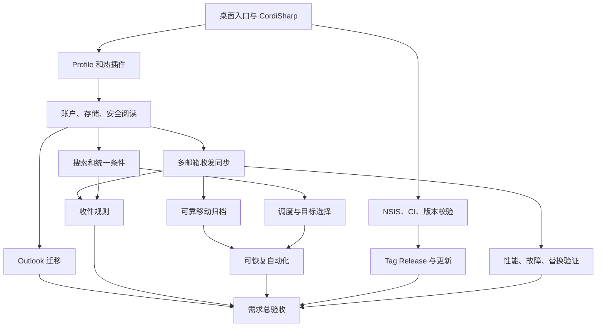

# 000-mymailbox · MyMailBox 开发任务索引

日期：2026 年 11 月 16 日。用户已确认按草案创建独立工单，**108 项均未开始**。

- [000-mymailbox 开发规格与完成标准](spec.md)
- [全部规格索引](../index.md)
- [需求覆盖矩阵](coverage.md)
- [评审草案快照](../../docs/开发任务拆分草案.md)
- [需求评估与技术依据](../../docs/需求与技术可行性评估.md)

## 规模与状态

| 范围 | 数量 | 处理方式 |
| --- | --- | --- |
| 必做及必要支撑 | 93 | 达成原始需求所需，按依赖推进 |
| 条件路线或实现 | 5 | 按公司部署/规则评估选择，不默认全部实施或全部跳过 |
| 可选扩展与范围决策 | 10 | 尚未选入首版；决策通过后按需细化 |

初始分诊：77 项 `ready-for-agent`、31 项 `needs-info`。所有 `Progress` 均为 `not-started`；ready 只表示任务说明就绪，不表示已解除依赖。

“依赖”列只列直接前置任务；外部环境在工单中列出。公司路线与规则导入还需执行 [规格中的条件门槛](spec.md)，不能只看普通依赖表就判定最终可验收。

## 从哪里开始

1. [01 验证阅读、写信与自动化的交互原型](issues/01-ux-prototype.md) 与 [02 启动并发布第一个插件化桌面应用](issues/02-app-bootstrap.md) 无开发前置，可并行开展。
2. 桌面入口具备后，推进 [03 用 CordiSharp 加载并卸载一个外部插件](issues/03-cordisharp-spike.md)；同时准备 [48 验证本机 Outlook 配置读取及位数边界](issues/48-outlook-discovery.md) 与 [50 用真实 PST 样本验证解析库和保真范围](issues/50-pst-spike.md) 的验证，真实样本不足时保留缺口。
3. [11 管理账户身份及仅收仅发能力](issues/11-accounts.md) 完成后立即推进 [35 验证公司 Exchange 的真实接入路径](issues/35-exchange-discovery.md)，尽早判断公司接入，不推到末尾。
4. 在各自依赖满足后，收发、迁移、搜索和发布基础工作可分别推进；自动化建立在相同条件与可靠动作上。
5. [98 按原始需求逐项完成发布前验收](issues/98-acceptance.md) 是原始需求总验收，只有必做和已选条件范围通过后才可完成；它不会自动触发发布。

## 主要依赖关系

## 工单清单

### A 框架与插件运行

| 编号与任务 | 范围 | 直接依赖 | 初始分诊 |
| --- | --- | --- | --- |
| [01 验证阅读、写信与自动化的交互原型](issues/01-ux-prototype.md) | 必做 | 无 | ready-for-agent |
| [02 启动并发布第一个插件化桌面应用](issues/02-app-bootstrap.md) | 必做 | 无 | ready-for-agent |
| [03 用 CordiSharp 加载并卸载一个外部插件](issues/03-cordisharp-spike.md) | 必做 | [02](issues/02-app-bootstrap.md) | ready-for-agent |
| [04 按核心 Profile 启动并恢复错误配置](issues/04-core-profile.md) | 必做 | [03](issues/03-cordisharp-spike.md) | ready-for-agent |
| [05 热重载普通插件配置并保留上次有效状态](issues/05-hot-config.md) | 必做 | [04](issues/04-core-profile.md) | ready-for-agent |
| [06 通过普通插件提供并替换页面和选择器](issues/06-ui-contributions.md) | 必做 | [05](issues/05-hot-config.md)、[01](issues/01-ux-prototype.md) | ready-for-agent |
| [07 在插件管理页安装启用和移除插件包](issues/07-plugin-packages.md) | 必做 | [05](issues/05-hot-config.md)、[06](issues/06-ui-contributions.md) | ready-for-agent |
| [08 在有在途操作时安全更新普通插件](issues/08-plugin-upgrade.md) | 必做 | [07](issues/07-plugin-packages.md) | ready-for-agent |
| [09 展示插件权限和可脱敏导出的诊断](issues/09-plugin-diagnostics.md) | 必做 | [07](issues/07-plugin-packages.md) | ready-for-agent |

### B 账户存储与安全阅读

| 编号与任务 | 范围 | 直接依赖 | 初始分诊 |
| --- | --- | --- | --- |
| [10 打开一封本地邮件并持久保存到工作空间](issues/10-local-inbox.md) | 必做 | [06](issues/06-ui-contributions.md) | ready-for-agent |
| [11 管理账户身份及仅收仅发能力](issues/11-accounts.md) | 必做 | [10](issues/10-local-inbox.md)、[09](issues/09-plugin-diagnostics.md) | ready-for-agent |
| [12 在写信与整理入口选择账户目录和身份](issues/12-selectors.md) | 必做 | [11](issues/11-accounts.md)、[06](issues/06-ui-contributions.md) | ready-for-agent |
| [13 保真阅读 MIME 邮件与原文](issues/13-mime-baseline.md) | 必做 | [10](issues/10-local-inbox.md) | ready-for-agent |
| [14 默认隔离地显示 HTML 邮件](issues/14-safe-html.md) | 必做 | [13](issues/13-mime-baseline.md) | ready-for-agent |
| [15 按本封或规则放行远程多媒体](issues/15-remote-content.md) | 必做 | [14](issues/14-safe-html.md) | ready-for-agent |
| [16 安全查看保存和打开附件](issues/16-attachments.md) | 必做 | [15](issues/15-remote-content.md) | ready-for-agent |
| [17 修复常见乱码并提供手动阅读回退](issues/17-encoding.md) | 必做 | [13](issues/13-mime-baseline.md)、[14](issues/14-safe-html.md) | ready-for-agent |
| [18 在磁盘满和崩溃后恢复本地邮箱](issues/18-storage-recovery.md) | 必做 | [10](issues/10-local-inbox.md)、[13](issues/13-mime-baseline.md) | ready-for-agent |
| [19 备份并恢复完整工作空间](issues/19-backup.md) | 必做 | [18](issues/18-storage-recovery.md)、[11](issues/11-accounts.md) | ready-for-agent |

### C 多邮箱收发与可靠操作

| 编号与任务 | 范围 | 直接依赖 | 初始分诊 |
| --- | --- | --- | --- |
| [20 添加 IMAP 账户并浏览真实目录摘要](issues/20-imap-connect.md) | 必做 | [11](issues/11-accounts.md)、[12](issues/12-selectors.md) | ready-for-agent |
| [21 增量接收 IMAP 邮件并离线阅读](issues/21-imap-sync.md) | 必做 | [20](issues/20-imap-connect.md)、[13](issues/13-mime-baseline.md)、[18](issues/18-storage-recovery.md) | ready-for-agent |
| [22 用发送账户完成一封纯文本邮件发送](issues/22-smtp-send.md) | 必做 | [11](issues/11-accounts.md)、[12](issues/12-selectors.md)、[13](issues/13-mime-baseline.md) | ready-for-agent |
| [23 使用富文本编辑并恢复草稿](issues/23-composer.md) | 必做 | [22](issues/22-smtp-send.md)、[14](issues/14-safe-html.md)、[01](issues/01-ux-prototype.md) | ready-for-agent |
| [24 在邮件中添加附件内联图片和签名](issues/24-compose-assets.md) | 必做 | [23](issues/23-composer.md)、[16](issues/16-attachments.md) | ready-for-agent |
| [25 持久化发件箱并处理不确定发送结果](issues/25-outbox.md) | 必做 | [22](issues/22-smtp-send.md)、[18](issues/18-storage-recovery.md) | ready-for-agent |
| [26 回复全部和转发时保留上下文与身份](issues/26-reply-forward.md) | 必做 | [23](issues/23-composer.md)、[24](issues/24-compose-assets.md)、[25](issues/25-outbox.md) | ready-for-agent |
| [27 用可替换地址建议完成收件人输入](issues/27-address-suggestions.md) | 必做 | [23](issues/23-composer.md)、[11](issues/11-accounts.md) | ready-for-agent |
| [28 安排稍后发送并取消尚未发送的邮件](issues/28-scheduled-send.md) | 必做 | [25](issues/25-outbox.md)、[23](issues/23-composer.md) | ready-for-agent |
| [29 通过 QQ 预设完成收发闭环](issues/29-qq.md) | 必做 | [21](issues/21-imap-sync.md)、[26](issues/26-reply-forward.md) | needs-info |
| [30 通过 163 预设完成收发闭环](issues/30-netease.md) | 必做 | [21](issues/21-imap-sync.md)、[26](issues/26-reply-forward.md) | needs-info |
| [31 通过 POP3 拉取邮件并控制服务器留存](issues/31-pop3.md) | 必做 | [11](issues/11-accounts.md)、[13](issues/13-mime-baseline.md)、[18](issues/18-storage-recovery.md) | ready-for-agent |
| [32 登录 Outlook.com 并阅读云端邮件](issues/32-graph-login.md) | 必做 | [11](issues/11-accounts.md)、[12](issues/12-selectors.md)、[13](issues/13-mime-baseline.md) | needs-info |
| [33 通过 Graph 发送并处理邮件状态](issues/33-graph-send.md) | 必做 | [32](issues/32-graph-login.md)、[26](issues/26-reply-forward.md) | needs-info |
| [34 增量同步 Graph 邮箱并恢复失效游标](issues/34-graph-sync.md) | 必做 | [32](issues/32-graph-login.md)、[18](issues/18-storage-recovery.md) | ready-for-agent |
| [35 验证公司 Exchange 的真实接入路径](issues/35-exchange-discovery.md) | 必做验证 | [02](issues/02-app-bootstrap.md)、[11](issues/11-accounts.md) | needs-info |
| [36 通过本地 Exchange 提供者浏览并读取邮件](issues/36-ews-read.md) | 条件路线：需要本地 Exchange/EWS 时 | [35](issues/35-exchange-discovery.md)、[12](issues/12-selectors.md)、[13](issues/13-mime-baseline.md) | needs-info |
| [37 完成公司 Exchange 的写信和邮件操作](issues/37-ews-send.md) | 条件路线：需要本地 Exchange/EWS 时 | [36](issues/36-ews-read.md)、[26](issues/26-reply-forward.md) | needs-info |
| [38 持续同步公司 Exchange 并恢复断网](issues/38-ews-sync.md) | 条件路线：需要本地 Exchange/EWS 时 | [36](issues/36-ews-read.md)、[18](issues/18-storage-recovery.md) | needs-info |
| [39 通过 Microsoft 365 组织账户完成收发](issues/39-exchange-online.md) | 条件路线：需要 Exchange Online 时 | [32](issues/32-graph-login.md)、[33](issues/33-graph-send.md)、[34](issues/34-graph-sync.md) | needs-info |
| [40 自动接收多个账户并展示统一同步状态](issues/40-multi-sync.md) | 必做 | [21](issues/21-imap-sync.md)、[31](issues/31-pop3.md)、[06](issues/06-ui-contributions.md) | ready-for-agent |
| [41 管理目录及邮件标签已读星标](issues/41-folders-flags.md) | 必做 | [21](issues/21-imap-sync.md)、[12](issues/12-selectors.md) | ready-for-agent |
| [42 在同一邮箱内复制移动和删除邮件](issues/42-same-store-actions.md) | 必做 | [41](issues/41-folders-flags.md) | ready-for-agent |
| [43 创建本地邮箱并按目录保存归档](issues/43-local-archive.md) | 必做 | [18](issues/18-storage-recovery.md)、[12](issues/12-selectors.md) | ready-for-agent |
| [44 可靠地将云端邮件复制或移动到本地](issues/44-cross-store-move.md) | 必做 | [43](issues/43-local-archive.md)、[42](issues/42-same-store-actions.md) | ready-for-agent |
| [45 恢复跨邮箱操作的每个中断点](issues/45-move-recovery.md) | 必做 | [44](issues/44-cross-store-move.md)、[08](issues/08-plugin-upgrade.md) | ready-for-agent |
| [46 处理多客户端修改删除和目录冲突](issues/46-sync-conflicts.md) | 必做 | [21](issues/21-imap-sync.md)、[41](issues/41-folders-flags.md)、[18](issues/18-storage-recovery.md) | ready-for-agent |
| [47 使用外部邮箱插件验证统一提供者契约](issues/47-provider-sdk.md) | 必做 | [33](issues/33-graph-send.md)、[40](issues/40-multi-sync.md)、[45](issues/45-move-recovery.md)、[46](issues/46-sync-conflicts.md) | ready-for-agent |

### D Outlook 迁移与导出

| 编号与任务 | 范围 | 直接依赖 | 初始分诊 |
| --- | --- | --- | --- |
| [48 验证本机 Outlook 配置读取及位数边界](issues/48-outlook-discovery.md) | 必做验证 | [02](issues/02-app-bootstrap.md) | needs-info |
| [49 预览并导入 Outlook 在线账户配置](issues/49-account-import.md) | 必做 | [48](issues/48-outlook-discovery.md)、[11](issues/11-accounts.md)、[12](issues/12-selectors.md) | needs-info |
| [50 用真实 PST 样本验证解析库和保真范围](issues/50-pst-spike.md) | 必做验证 | [02](issues/02-app-bootstrap.md) | needs-info |
| [51 导入 PST 目录和邮件并查看进度](issues/51-pst-import.md) | 必做 | [50](issues/50-pst-spike.md)、[43](issues/43-local-archive.md)、[13](issues/13-mime-baseline.md) | ready-for-agent |
| [52 完成 PST 复杂邮件的保真与异常报告](issues/52-pst-fidelity.md) | 必做 | [51](issues/51-pst-import.md)、[17](issues/17-encoding.md)、[16](issues/16-attachments.md) | ready-for-agent |
| [53 在重启和插件停用后继续导入](issues/53-import-resume.md) | 必做 | [49](issues/49-account-import.md)、[51](issues/51-pst-import.md)、[08](issues/08-plugin-upgrade.md) | ready-for-agent |
| [54 识别可转换的 Outlook 规则子集](issues/54-rules-import-spike.md) | 必做验证 | [48](issues/48-outlook-discovery.md) | needs-info |
| [55 单封和批量导出原始 EML](issues/55-eml-export.md) | 必做 | [13](issues/13-mime-baseline.md)、[12](issues/12-selectors.md) | ready-for-agent |
| [56 导出并重新导入可搬运邮箱归档包](issues/56-archive-export.md) | 必做 | [19](issues/19-backup.md)、[55](issues/55-eml-export.md) | ready-for-agent |
| [57 将邮件导出为 PDF HTML 和纯文本](issues/57-readable-export.md) | 必做 | [14](issues/14-safe-html.md)、[55](issues/55-eml-export.md) | ready-for-agent |
| [58 批量导出附件和邮件元数据](issues/58-bulk-export.md) | 必做 | [55](issues/55-eml-export.md)、[16](issues/16-attachments.md) | ready-for-agent |

### E 搜索与收件规则

| 编号与任务 | 范围 | 直接依赖 | 初始分诊 |
| --- | --- | --- | --- |
| [59 按邮件字段搜索并定位结果](issues/59-search-fields.md) | 必做 | [13](issues/13-mime-baseline.md)、[41](issues/41-folders-flags.md) | ready-for-agent |
| [60 组合 AND OR NOT 与字符串正则条件](issues/60-query-language.md) | 必做 | [59](issues/59-search-fields.md) | ready-for-agent |
| [61 搜索中文和多语言正文内容](issues/61-fulltext.md) | 必做 | [59](issues/59-search-fields.md)、[17](issues/17-encoding.md) | ready-for-agent |
| [62 用可视化条件构建并保存高级搜索](issues/62-search-builder.md) | 必做 | [60](issues/60-query-language.md)、[61](issues/61-fulltext.md)、[12](issues/12-selectors.md) | ready-for-agent |
| [63 在慢查询中更改条件并继续阅读](issues/63-search-cancel.md) | 必做 | [62](issues/62-search-builder.md)、[40](issues/40-multi-sync.md) | ready-for-agent |
| [64 通过外部插件增加搜索字段和运算符](issues/64-search-plugin.md) | 必做 | [60](issues/60-query-language.md)、[61](issues/61-fulltext.md)、[07](issues/07-plugin-packages.md) | ready-for-agent |
| [65 新邮件到达时执行可配置规则](issues/65-receive-rules.md) | 必做 | [60](issues/60-query-language.md)、[42](issues/42-same-store-actions.md)、[40](issues/40-multi-sync.md) | ready-for-agent |
| [66 确保正文规则和重试不会重复产生副作用](issues/66-rule-stages.md) | 必做 | [65](issues/65-receive-rules.md)、[21](issues/21-imap-sync.md)、[44](issues/44-cross-store-move.md) | ready-for-agent |
| [67 预览规则命中并解释执行失败](issues/67-rule-preview.md) | 必做 | [66](issues/66-rule-stages.md)、[62](issues/62-search-builder.md) | ready-for-agent |
| [68 转换并预览可支持的 Outlook 规则](issues/68-rules-import.md) | 条件项：按规则导入评估结论 | [54](issues/54-rules-import-spike.md)、[67](issues/67-rule-preview.md)、[49](issues/49-account-import.md) | needs-info |

### F 调度与自动化

| 编号与任务 | 范围 | 直接依赖 | 初始分诊 |
| --- | --- | --- | --- |
| [69 创建一次性提醒并可靠通知](issues/69-reminder.md) | 必做 | [12](issues/12-selectors.md)、[18](issues/18-storage-recovery.md)、[06](issues/06-ui-contributions.md) | ready-for-agent |
| [70 配置日周月与相对周几的循环任务](issues/70-recurrence.md) | 必做 | [69](issues/69-reminder.md) | ready-for-agent |
| [71 支持 CRON 时区与夏令时预览](issues/71-cron-timezone.md) | 必做 | [70](issues/70-recurrence.md) | ready-for-agent |
| [72 恢复错过的调度并控制重叠与重试](issues/72-scheduler-recovery.md) | 必做 | [71](issues/71-cron-timezone.md)、[18](issues/18-storage-recovery.md) | ready-for-agent |
| [73 按数量空间和存在条件决定是否运行](issues/73-task-preconditions.md) | 必做 | [60](issues/60-query-language.md)、[40](issues/40-multi-sync.md)、[69](issues/69-reminder.md) | ready-for-agent |
| [74 独立选择任务实际处理的邮件集合](issues/74-task-targets.md) | 必做 | [73](issues/73-task-preconditions.md)、[62](issues/62-search-builder.md) | ready-for-agent |
| [75 按计划把超过 30 天的邮件归档到本地](issues/75-archive-task.md) | 必做 | [74](issues/74-task-targets.md)、[45](issues/45-move-recovery.md)、[72](issues/72-scheduler-recovery.md) | ready-for-agent |
| [76 在任务中组合复制标记导出和提醒动作](issues/76-task-actions.md) | 必做 | [75](issues/75-archive-task.md)、[58](issues/58-bulk-export.md)、[42](issues/42-same-store-actions.md) | ready-for-agent |
| [77 通过事件手动操作和前置任务触发自动化](issues/77-event-tasks.md) | 必做 | [72](issues/72-scheduler-recovery.md)、[66](issues/66-rule-stages.md)、[76](issues/76-task-actions.md) | ready-for-agent |
| [78 审查自动化历史并从失败步骤继续](issues/78-task-history.md) | 必做 | [75](issues/75-archive-task.md)、[77](issues/77-event-tasks.md) | ready-for-agent |
| [79 用外部条件动作和调度插件运行任务](issues/79-automation-sdk.md) | 必做 | [64](issues/64-search-plugin.md)、[78](issues/78-task-history.md)、[08](issues/08-plugin-upgrade.md) | ready-for-agent |
| [80 集中管理同步提醒和任务通知](issues/80-notifications.md) | 必做 | [69](issues/69-reminder.md)、[40](issues/40-multi-sync.md)、[78](issues/78-task-history.md) | ready-for-agent |

### G 体验性能与可靠性

| 编号与任务 | 范围 | 直接依赖 | 初始分诊 |
| --- | --- | --- | --- |
| [81 完成键盘与无障碍的核心使用路径](issues/81-ux-acceptance.md) | 必做 | [26](issues/26-reply-forward.md)、[63](issues/63-search-cancel.md)、[78](issues/78-task-history.md)、[80](issues/80-notifications.md) | ready-for-agent |
| [82 建立可复用的大邮箱验收数据集](issues/82-performance-fixtures.md) | 必做 | [63](issues/63-search-cancel.md)、[75](issues/75-archive-task.md) | ready-for-agent |
| [83 达到长列表搜索阅读和后台任务性能目标](issues/83-performance.md) | 必做 | [82](issues/82-performance-fixtures.md) | ready-for-agent |
| [84 联调各提供者的故障与恢复矩阵](issues/84-reliability.md) | 必做 | [47](issues/47-provider-sdk.md)、[78](issues/78-task-history.md)、[46](issues/46-sync-conflicts.md)、[35](issues/35-exchange-discovery.md)、[29](issues/29-qq.md)、[30](issues/30-netease.md)、[34](issues/34-graph-sync.md)、[33](issues/33-graph-send.md) | needs-info |
| [85 受控地自动回复转发与调用外部动作](issues/85-automatic-replies.md) | 必要补充：默认关闭的高影响动作 | [67](issues/67-rule-preview.md)、[76](issues/76-task-actions.md)、[25](issues/25-outbox.md)、[09](issues/09-plugin-diagnostics.md) | needs-info |

### H 打包发布与验收

| 编号与任务 | 范围 | 直接依赖 | 初始分诊 |
| --- | --- | --- | --- |
| [86 使用 NSIS 安装卸载框架依赖应用](issues/86-installer.md) | 必做 | [02](issues/02-app-bootstrap.md)、[19](issues/19-backup.md) | ready-for-agent |
| [87 验证 NuGet 更新组件与 NSIS 的最小升级](issues/87-updater-spike.md) | 必做验证 | [86](issues/86-installer.md)、[09](issues/09-plugin-diagnostics.md) | needs-info |
| [88 在设置页和后台检查 GitHub 新版本](issues/88-update-check.md) | 必做 | [87](issues/87-updater-spike.md)、[06](issues/06-ui-contributions.md) | needs-info |
| [89 下载验证并安装更新且保留用户数据](issues/89-update-install.md) | 必做 | [88](issues/88-update-check.md)、[86](issues/86-installer.md)、[19](issues/19-backup.md)、[08](issues/08-plugin-upgrade.md) | ready-for-agent |
| [90 校验版本与提取对应 changelog 条目](issues/90-release-metadata.md) | 必做 | [02](issues/02-app-bootstrap.md) | ready-for-agent |
| [91 在 GitHub Actions 构建并验证 NSIS 产物](issues/91-ci-build.md) | 必做 | [86](issues/86-installer.md)、[90](issues/90-release-metadata.md) | ready-for-agent |
| [92 由 V 或 v Tag 自动发布完整 GitHub Release](issues/92-tag-release.md) | 必做 | [91](issues/91-ci-build.md)、[87](issues/87-updater-spike.md) | needs-info |
| [93 验证从已安装旧版到 Actions 新版的升级](issues/93-update-e2e.md) | 必做 | [92](issues/92-tag-release.md)、[89](issues/89-update-install.md) | needs-info |
| [94 验证每一类内置能力都可被外部实现替换](issues/94-extensibility-audit.md) | 必做 | [47](issues/47-provider-sdk.md)、[53](issues/53-import-resume.md)、[58](issues/58-bulk-export.md)、[64](issues/64-search-plugin.md)、[79](issues/79-automation-sdk.md)、[88](issues/88-update-check.md)、[08](issues/08-plugin-upgrade.md) | ready-for-agent |
| [97 完成安装迁移与故障恢复的使用指引](issues/97-user-guides.md) | 必做 | [53](issues/53-import-resume.md)、[56](issues/56-archive-export.md)、[78](issues/78-task-history.md)、[93](issues/93-update-e2e.md)、[95](issues/95-settings-transfer.md)、[96](issues/96-tray-lifetime.md) | ready-for-agent |
| [98 按原始需求逐项完成发布前验收](issues/98-acceptance.md) | 必做 | [81](issues/81-ux-acceptance.md)、[83](issues/83-performance.md)、[84](issues/84-reliability.md)、[85](issues/85-automatic-replies.md)、[52](issues/52-pst-fidelity.md)、[94](issues/94-extensibility-audit.md)、[97](issues/97-user-guides.md)、[27](issues/27-address-suggestions.md)、[28](issues/28-scheduled-send.md)、[54](issues/54-rules-import-spike.md)、[57](issues/57-readable-export.md) | needs-info |

### I 配置迁移与运行方式

| 编号与任务 | 范围 | 直接依赖 | 初始分诊 |
| --- | --- | --- | --- |
| [95 导出并重新映射账户规则和任务模板](issues/95-settings-transfer.md) | 必要补充：配置迁移 | [49](issues/49-account-import.md)、[78](issues/78-task-history.md)、[56](issues/56-archive-export.md) | ready-for-agent |
| [96 在托盘运行期间持续收件并执行任务](issues/96-tray-lifetime.md) | 必要补充：后台运行语义 | [40](issues/40-multi-sync.md)、[72](issues/72-scheduler-recovery.md)、[80](issues/80-notifications.md) | ready-for-agent |

### J 可选扩展及后续决策

| 编号与任务 | 范围 | 直接依赖 | 初始分诊 |
| --- | --- | --- | --- |
| [99 增加 MBOX 与 Maildir 迁移插件](issues/99-mbox-maildir.md) | 可选扩展，未计入原始必做 | [53](issues/53-import-resume.md)、[55](issues/55-eml-export.md) | needs-info |
| [100 按附件正文检索并显示来源](issues/100-attachment-search.md) | 可选扩展，未计入原始必做 | [64](issues/64-search-plugin.md)、[16](issues/16-attachments.md) | needs-info |
| [101 增加基于经典 Outlook 的第二 PST 导入器](issues/101-outlook-pst-adapter.md) | 可选扩展，未计入原始必做 | [48](issues/48-outlook-discovery.md)、[53](issues/53-import-resume.md)、[52](issues/52-pst-fidelity.md) | needs-info |
| [102 评估 MSG 与 PST 导出并确定实施范围](issues/102-msg-pst-export.md) | 可选扩展决策，确认后继续拆分 | [55](issues/55-eml-export.md)、[50](issues/50-pst-spike.md) | needs-info |
| [103 验证并提供 S/MIME 签名与加密阅读发送](issues/103-smime.md) | 可选扩展，需进一步细化后实施 | [16](issues/16-attachments.md)、[26](issues/26-reply-forward.md)、[09](issues/09-plugin-diagnostics.md) | needs-info |
| [104 评估 PGP 密钥与加密邮件插件](issues/104-pgp.md) | 可选扩展决策，确认后继续拆分 | [16](issues/16-attachments.md)、[26](issues/26-reply-forward.md)、[09](issues/09-plugin-diagnostics.md) | needs-info |
| [105 验证共享邮箱委托与企业受保护邮件范围](issues/105-enterprise-extras.md) | 可选扩展决策，确认后继续拆分 | [35](issues/35-exchange-discovery.md)、[33](issues/33-graph-send.md) | needs-info |
| [106 决定并验证完全退出 GUI 后的任务运行](issues/106-background-mode.md) | 可选扩展决策，确认后继续拆分 | [72](issues/72-scheduler-recovery.md)、[11](issues/11-accounts.md)、[86](issues/86-installer.md) | needs-info |
| [107 决定单文件运行存储与整库加密范围](issues/107-storage-choices.md) | 可选扩展决策，确认后继续拆分 | [19](issues/19-backup.md)、[56](issues/56-archive-export.md)、[61](issues/61-fulltext.md) | needs-info |
| [108 界定联系人和日历是否扩展为独立产品功能](issues/108-contacts-calendar.md) | 可选扩展决策，确认后继续拆分 | [49](issues/49-account-import.md)、[52](issues/52-pst-fidelity.md)、[27](issues/27-address-suggestions.md) | needs-info |
