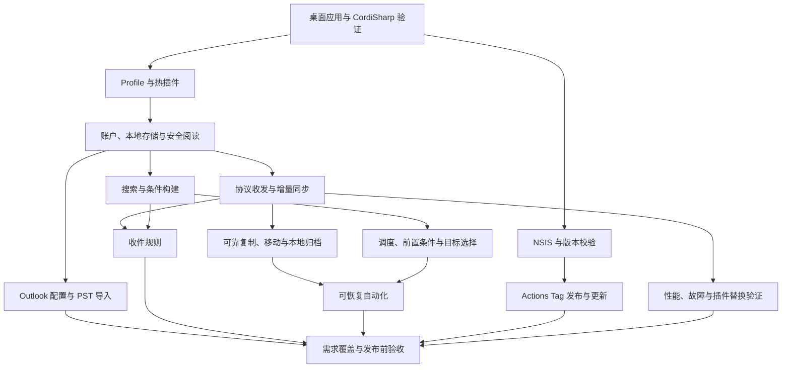

# MyMailBox 开发任务拆分草案

日期：2026 年 11 月 16 日。当前状态：用户已确认拆分，108 个独立工单已创建，尚未开始应用开发。本文件保留评审快照；后续任务状态与依赖以[正式任务索引](../.scratch/mymailbox/index.md)、[规格](../.scratch/mymailbox/spec.md)和各工单为准。

依据：[已确认需求与评估](需求与技术可行性评估.md)、[项目执行规范](../AGENTS.md)。本草案将原始要求与后续决定映射为 **108 项：93 项必做及必要支撑、5 项条件路线/条件实现、10 项可选扩展或范围决策**。可选事项不是自动增加的发布义务。

## 约束与粒度

- 确定路线为 Avalonia、C#、.NET 10、win-x64、全 JIT、框架依赖发布，系统运行时由用户安装；优先复用 CordiSharp。AOT/WASM 选型不再列开发任务。
- 一个实现任务应交付可演示或可测量的完整路径，包含所需数据、服务、UI、插件接入、错误处理和适当验证；不另拆成“只建表/只写接口/只做页面”的水平任务。
- 估算以 **2–3 人日**为常见目标，不含账户/样本/审批等待，也不是进度承诺。实际探查发现超出此粒度时，在实现前按可验收子场景继续拆分。可选范围决策只负责产出证据及后续细分，不冒充功能已经实现。
- 开发依赖与外部条件分开。编号已按显式依赖拓扑排序，但编号不是强制串行时间表；未列相互依赖的工作可并行推进。
- 每项正式工单将单独写入 `.scratch/mymailbox/issues/<编号>-<英文短名>.md`。就绪表示描述足够清楚，不表示依赖已完成；外部环境不足和未确认扩展标为 `needs-info`。
- 本次只规划任务，不生成 changelog、不打 Tag、不推送、不发布，也不访问真实邮箱。届时已有授权按其范围执行，不重复索取。
- 验证复用已有安装包、SDK、依赖和邮件样本；GUI 验收前准备构建、数据和证据点，集中验证后结束测试进程。下载功能验证一次后复用产物，Release 摘要优先使用平台信息。

## 分组总览

| 分组 | 数量 | 任务编号 |
| --- | --- | --- |
| A 框架与插件运行 | 9 | 01、02、03、04、05、06、07、08、09 |
| B 账户存储与安全阅读 | 10 | 10、11、12、13、14、15、16、17、18、19 |
| C 多邮箱收发与可靠操作 | 28 | 20、21、22、23、24、25、26、27、28、29、30、31、32、33、34、35、36、37、38、39、40、41、42、43、44、45、46、47 |
| D Outlook 迁移与导出 | 11 | 48、49、50、51、52、53、54、55、56、57、58 |
| E 搜索与收件规则 | 10 | 59、60、61、62、63、64、65、66、67、68 |
| F 调度与自动化 | 12 | 69、70、71、72、73、74、75、76、77、78、79、80 |
| G 体验性能与可靠性 | 5 | 81、82、83、84、85 |
| H 打包发布与验收 | 11 | 86、87、88、89、90、91、92、93、94、97、98 |
| I 配置迁移与运行方式 | 2 | 95、96 |
| J 可选扩展及后续决策 | 10 | 99、100、101、102、103、104、105、106、107、108 |

## 建议实施顺序与通过门槛

1. **打通第一条路径**：01、02 可先开始；02 后启动 CordiSharp 验证，同时推进 Outlook 配置读取和 PST 解析验证。形成“插件 → 本地邮件 → 阅读”的闭环。
2. **提前解决接入风险**：账户能力具备后立即进行公司 Exchange 验证，不等其他功能全部完成才验证。UI/普通插件可独立开发，真实接入结论不能用模拟替代。
3. **收发与迁移闭环**：逐个接入 IMAP/SMTP、POP3、QQ、163、Outlook.com 和实际公司路线；完成 Outlook 配置导入与 PST 导入。任一必做项缺失均不宣称原始需求已满足。
4. **搜索与自动化闭环**：复用统一条件语义；依次做到查询、收件规则、调度/前置条件/目标选择、跨邮箱归档和故障恢复。
5. **发布准备与验收**：NSIS、CI 和版本校验在依赖满足后可提前开发；应用更新和真实 Tag 发布在对应授权与配置具备时联调。最终按需求矩阵验收，不用“接口存在”代替插件替换测试。
6. **可选扩展**：只在明确选入范围后实施；其中标为决策的任务完成后，还需产生足够细的实现工单，不能把一份研究结论算作功能完成。

公司 Exchange 的条件依赖：先完成 **35**；本地 EWS 路线选择 **36、37、38**，组织 Graph 路线选择 **39**；混合部署按实际邮箱位置验收。若只有协议降级可用，须明确被接受的功能边界。**84 与 98 的完成受所选路线实际通过约束**，不是任选一个模拟环境即可跳过。

规则导入先完成 **54**；可行的子集通过 **68** 转换和验证。若接口确实无法满足，应保留证据与未支持项，不改变“评估可否导入”的原要求。

仓库地址、公司网络/授权、Outlook 位数、测试账户与 PST 样本在对应任务实施时收集；它们不妨碍现在拆任务，也不提前索要 GitHub 地址。

## 主要依赖关系

下图展示主要交付路径；具体先决任务以每项“依赖”为准，条件路线按门槛选择，并非所有框必须串行完成。

## 编号任务清单

每项依赖均指本草案编号；需求编号见下方覆盖矩阵。

1. **01 验证阅读、写信与自动化的交互原型**（必做）
   - 依赖：无，可独立开始。
   - 覆盖：REQ-19、REQ-16。

2. **02 启动并发布第一个插件化桌面应用**（必做）
   - 依赖：无，可独立开始。
   - 覆盖：REQ-01、REQ-04。

3. **03 用 CordiSharp 加载并卸载一个外部插件**（必做）
   - 依赖：02。
   - 覆盖：REQ-04、REQ-17。

4. **04 按核心 Profile 启动并恢复错误配置**（必做）
   - 依赖：03。
   - 覆盖：REQ-17。

5. **05 热重载普通插件配置并保留上次有效状态**（必做）
   - 依赖：04。
   - 覆盖：REQ-17。

6. **06 通过普通插件提供并替换页面和选择器**（必做）
   - 依赖：05、01。
   - 覆盖：REQ-16、REQ-17、REQ-19。

7. **07 在插件管理页安装启用和移除插件包**（必做）
   - 依赖：05、06。
   - 覆盖：REQ-04、REQ-17、SUP-02。

8. **08 在有在途操作时安全更新普通插件**（必做）
   - 依赖：07。
   - 覆盖：REQ-17、SUP-01。

9. **09 展示插件权限和可脱敏导出的诊断**（必做）
   - 依赖：07。
   - 覆盖：SUP-02、REQ-04。

10. **10 打开一封本地邮件并持久保存到工作空间**（必做）
   - 依赖：06。
   - 覆盖：REQ-05、SUP-01、REQ-23。

11. **11 管理账户身份及仅收仅发能力**（必做）
   - 依赖：10、09。
   - 覆盖：REQ-18、REQ-05、SUP-02。

12. **12 在写信与整理入口选择账户目录和身份**（必做）
   - 依赖：11、06。
   - 覆盖：REQ-16、REQ-18、REQ-19。

13. **13 保真阅读 MIME 邮件与原文**（必做）
   - 依赖：10。
   - 覆盖：REQ-22、REQ-07。

14. **14 默认隔离地显示 HTML 邮件**（必做）
   - 依赖：13。
   - 覆盖：REQ-22。

15. **15 按本封或规则放行远程多媒体**（必做）
   - 依赖：14。
   - 覆盖：REQ-22、REQ-19。

16. **16 安全查看保存和打开附件**（必做）
   - 依赖：15。
   - 覆盖：REQ-22、REQ-20。

17. **17 修复常见乱码并提供手动阅读回退**（必做）
   - 依赖：13、14。
   - 覆盖：REQ-22。

18. **18 在磁盘满和崩溃后恢复本地邮箱**（必做）
   - 依赖：10、13。
   - 覆盖：SUP-01、REQ-05。

19. **19 备份并恢复完整工作空间**（必做）
   - 依赖：18、11。
   - 覆盖：SUP-01、REQ-09。

20. **20 添加 IMAP 账户并浏览真实目录摘要**（必做）
   - 依赖：11、12。
   - 覆盖：REQ-05、REQ-21。

21. **21 增量接收 IMAP 邮件并离线阅读**（必做）
   - 依赖：20、13、18。
   - 覆盖：REQ-21、REQ-22、REQ-23。

22. **22 用发送账户完成一封纯文本邮件发送**（必做）
   - 依赖：11、12、13。
   - 覆盖：REQ-05、REQ-20。

23. **23 使用富文本编辑并恢复草稿**（必做）
   - 依赖：22、14、01。
   - 覆盖：REQ-20、REQ-19。

24. **24 在邮件中添加附件内联图片和签名**（必做）
   - 依赖：23、16。
   - 覆盖：REQ-20。

25. **25 持久化发件箱并处理不确定发送结果**（必做）
   - 依赖：22、18。
   - 覆盖：REQ-20、SUP-01。

26. **26 回复全部和转发时保留上下文与身份**（必做）
   - 依赖：23、24、25。
   - 覆盖：REQ-20、REQ-19。

27. **27 用可替换地址建议完成收件人输入**（必做）
   - 依赖：23、11。
   - 覆盖：REQ-20、REQ-16。

28. **28 安排稍后发送并取消尚未发送的邮件**（必做）
   - 依赖：25、23。
   - 覆盖：REQ-20。

29. **29 通过 QQ 预设完成收发闭环**（必做）
   - 依赖：21、26。
   - 覆盖：REQ-05、REQ-20、REQ-21。

30. **30 通过 163 预设完成收发闭环**（必做）
   - 依赖：21、26。
   - 覆盖：REQ-05、REQ-20、REQ-21。

31. **31 通过 POP3 拉取邮件并控制服务器留存**（必做）
   - 依赖：11、13、18。
   - 覆盖：REQ-05、REQ-21。

32. **32 登录 Outlook.com 并阅读云端邮件**（必做）
   - 依赖：11、12、13。
   - 覆盖：REQ-05、REQ-21。

33. **33 通过 Graph 发送并处理邮件状态**（必做）
   - 依赖：32、26。
   - 覆盖：REQ-05、REQ-20。

34. **34 增量同步 Graph 邮箱并恢复失效游标**（必做）
   - 依赖：32、18。
   - 覆盖：REQ-21、REQ-23。

35. **35 验证公司 Exchange 的真实接入路径**（必做验证）
   - 依赖：02、11。
   - 覆盖：REQ-05、REQ-21、REQ-20。

36. **36 通过本地 Exchange 提供者浏览并读取邮件**（条件路线：需要本地 Exchange/EWS 时）
   - 依赖：35、12、13。
   - 覆盖：REQ-05、REQ-21。

37. **37 完成公司 Exchange 的写信和邮件操作**（条件路线：需要本地 Exchange/EWS 时）
   - 依赖：36、26。
   - 覆盖：REQ-05、REQ-20。

38. **38 持续同步公司 Exchange 并恢复断网**（条件路线：需要本地 Exchange/EWS 时）
   - 依赖：36、18。
   - 覆盖：REQ-21、REQ-23。

39. **39 通过 Microsoft 365 组织账户完成收发**（条件路线：需要 Exchange Online 时）
   - 依赖：32、33、34。
   - 覆盖：REQ-05、REQ-20、REQ-21。

40. **40 自动接收多个账户并展示统一同步状态**（必做）
   - 依赖：21、31、06。
   - 覆盖：REQ-21、REQ-18、REQ-19。

41. **41 管理目录及邮件标签已读星标**（必做）
   - 依赖：21、12。
   - 覆盖：REQ-05、REQ-18、REQ-19。

42. **42 在同一邮箱内复制移动和删除邮件**（必做）
   - 依赖：41。
   - 覆盖：REQ-15、REQ-05。

43. **43 创建本地邮箱并按目录保存归档**（必做）
   - 依赖：18、12。
   - 覆盖：REQ-05、REQ-18。

44. **44 可靠地将云端邮件复制或移动到本地**（必做）
   - 依赖：43、42。
   - 覆盖：REQ-15、SUP-01。

45. **45 恢复跨邮箱操作的每个中断点**（必做）
   - 依赖：44、08。
   - 覆盖：REQ-15、SUP-01。

46. **46 处理多客户端修改删除和目录冲突**（必做）
   - 依赖：21、41、18。
   - 覆盖：REQ-21、SUP-01。

47. **47 使用外部邮箱插件验证统一提供者契约**（必做）
   - 依赖：33、40、45、46。
   - 覆盖：REQ-05、REQ-04。

48. **48 验证本机 Outlook 配置读取及位数边界**（必做验证）
   - 依赖：02。
   - 覆盖：REQ-06、REQ-07。

49. **49 预览并导入 Outlook 在线账户配置**（必做）
   - 依赖：48、11、12。
   - 覆盖：REQ-06。

50. **50 用真实 PST 样本验证解析库和保真范围**（必做验证）
   - 依赖：02。
   - 覆盖：REQ-07。

51. **51 导入 PST 目录和邮件并查看进度**（必做）
   - 依赖：50、43、13。
   - 覆盖：REQ-07。

52. **52 完成 PST 复杂邮件的保真与异常报告**（必做）
   - 依赖：51、17、16。
   - 覆盖：REQ-07、REQ-22。

53. **53 在重启和插件停用后继续导入**（必做）
   - 依赖：49、51、08。
   - 覆盖：REQ-06、REQ-07、REQ-04、SUP-01。

54. **54 识别可转换的 Outlook 规则子集**（必做验证）
   - 依赖：48。
   - 覆盖：REQ-08。

55. **55 单封和批量导出原始 EML**（必做）
   - 依赖：13、12。
   - 覆盖：REQ-09。

56. **56 导出并重新导入可搬运邮箱归档包**（必做）
   - 依赖：19、55。
   - 覆盖：REQ-09、SUP-01。

57. **57 将邮件导出为 PDF HTML 和纯文本**（必做）
   - 依赖：14、55。
   - 覆盖：REQ-09。

58. **58 批量导出附件和邮件元数据**（必做）
   - 依赖：55、16。
   - 覆盖：REQ-09。

59. **59 按邮件字段搜索并定位结果**（必做）
   - 依赖：13、41。
   - 覆盖：REQ-10。

60. **60 组合 AND OR NOT 与字符串正则条件**（必做）
   - 依赖：59。
   - 覆盖：REQ-10、REQ-11、REQ-13、REQ-14。

61. **61 搜索中文和多语言正文内容**（必做）
   - 依赖：59、17。
   - 覆盖：REQ-10、REQ-23。

62. **62 用可视化条件构建并保存高级搜索**（必做）
   - 依赖：60、61、12。
   - 覆盖：REQ-10、REQ-14、REQ-19。

63. **63 在慢查询中更改条件并继续阅读**（必做）
   - 依赖：62、40。
   - 覆盖：REQ-10、REQ-23。

64. **64 通过外部插件增加搜索字段和运算符**（必做）
   - 依赖：60、61、07。
   - 覆盖：REQ-10、REQ-04。

65. **65 新邮件到达时执行可配置规则**（必做）
   - 依赖：60、42、40。
   - 覆盖：REQ-11、REQ-21。

66. **66 确保正文规则和重试不会重复产生副作用**（必做）
   - 依赖：65、21、44。
   - 覆盖：REQ-11、SUP-01。

67. **67 预览规则命中并解释执行失败**（必做）
   - 依赖：66、62。
   - 覆盖：REQ-11、REQ-19、SUP-02。

68. **68 转换并预览可支持的 Outlook 规则**（条件项：按规则导入评估结论）
   - 依赖：54、67、49。
   - 覆盖：REQ-08。

69. **69 创建一次性提醒并可靠通知**（必做）
   - 依赖：12、18、06。
   - 覆盖：REQ-12、REQ-15。

70. **70 配置日周月与相对周几的循环任务**（必做）
   - 依赖：69。
   - 覆盖：REQ-12。

71. **71 支持 CRON 时区与夏令时预览**（必做）
   - 依赖：70。
   - 覆盖：REQ-12。

72. **72 恢复错过的调度并控制重叠与重试**（必做）
   - 依赖：71、18。
   - 覆盖：REQ-12、SUP-01。

73. **73 按数量空间和存在条件决定是否运行**（必做）
   - 依赖：60、40、69。
   - 覆盖：REQ-13。

74. **74 独立选择任务实际处理的邮件集合**（必做）
   - 依赖：73、62。
   - 覆盖：REQ-14、REQ-19。

75. **75 按计划把超过 30 天的邮件归档到本地**（必做）
   - 依赖：74、45、72。
   - 覆盖：REQ-12、REQ-13、REQ-14、REQ-15。

76. **76 在任务中组合复制标记导出和提醒动作**（必做）
   - 依赖：75、58、42。
   - 覆盖：REQ-15。

77. **77 通过事件手动操作和前置任务触发自动化**（必做）
   - 依赖：72、66、76。
   - 覆盖：REQ-12、REQ-13、REQ-15。

78. **78 审查自动化历史并从失败步骤继续**（必做）
   - 依赖：75、77。
   - 覆盖：REQ-15、REQ-19、SUP-01。

79. **79 用外部条件动作和调度插件运行任务**（必做）
   - 依赖：64、78、08。
   - 覆盖：REQ-11、REQ-12、REQ-13、REQ-14、REQ-15、REQ-04。

80. **80 集中管理同步提醒和任务通知**（必做）
   - 依赖：69、40、78。
   - 覆盖：REQ-19、REQ-15、REQ-16。

81. **81 完成键盘与无障碍的核心使用路径**（必做）
   - 依赖：26、63、78、80。
   - 覆盖：REQ-19、REQ-16。

82. **82 建立可复用的大邮箱验收数据集**（必做）
   - 依赖：63、75。
   - 覆盖：REQ-23、SUP-01。

83. **83 达到长列表搜索阅读和后台任务性能目标**（必做）
   - 依赖：82。
   - 覆盖：REQ-23。

84. **84 联调各提供者的故障与恢复矩阵**（必做）
   - 依赖：47、78、46、35、29、30、34、33。
   - 覆盖：REQ-05、REQ-21、SUP-01、SUP-02。

85. **85 受控地自动回复转发与调用外部动作**（必要补充：默认关闭的高影响动作）
   - 依赖：67、76、25、09。
   - 覆盖：REQ-11、REQ-15、SUP-02。

86. **86 使用 NSIS 安装卸载框架依赖应用**（必做）
   - 依赖：02、19。
   - 覆盖：REQ-02、REQ-01。

87. **87 验证 NuGet 更新组件与 NSIS 的最小升级**（必做验证）
   - 依赖：86、09。
   - 覆盖：REQ-03。

88. **88 在设置页和后台检查 GitHub 新版本**（必做）
   - 依赖：87、06。
   - 覆盖：REQ-03、REQ-19。

89. **89 下载验证并安装更新且保留用户数据**（必做）
   - 依赖：88、86、19、08。
   - 覆盖：REQ-03、SUP-01。

90. **90 校验版本与提取对应 changelog 条目**（必做）
   - 依赖：02。
   - 覆盖：REQ-24。

91. **91 在 GitHub Actions 构建并验证 NSIS 产物**（必做）
   - 依赖：86、90。
   - 覆盖：REQ-24、REQ-02。

92. **92 由 V 或 v Tag 自动发布完整 GitHub Release**（必做）
   - 依赖：91、87。
   - 覆盖：REQ-24、REQ-03。

93. **93 验证从已安装旧版到 Actions 新版的升级**（必做）
   - 依赖：92、89。
   - 覆盖：REQ-02、REQ-03、REQ-24、SUP-01。

94. **94 验证每一类内置能力都可被外部实现替换**（必做）
   - 依赖：47、53、58、64、79、88、08。
   - 覆盖：REQ-04、REQ-05、REQ-06、REQ-07、REQ-09、REQ-10、REQ-11、REQ-12、REQ-13、REQ-14、REQ-15、REQ-16、REQ-17、REQ-18、REQ-20、REQ-21、REQ-22。

95. **95 导出并重新映射账户规则和任务模板**（必要补充：配置迁移）
   - 依赖：49、78、56。
   - 覆盖：REQ-09、REQ-11、REQ-17、REQ-18、SUP-01。

96. **96 在托盘运行期间持续收件并执行任务**（必要补充：后台运行语义）
   - 依赖：40、72、80。
   - 覆盖：REQ-21、REQ-12、REQ-19。

97. **97 完成安装迁移与故障恢复的使用指引**（必做）
   - 依赖：53、56、78、93、95、96。
   - 覆盖：REQ-19、REQ-02、REQ-06、REQ-07、SUP-01。

98. **98 按原始需求逐项完成发布前验收**（必做）
   - 依赖：81、83、84、85、52、94、97、27、28、54、57。
   - 覆盖：REQ-01、REQ-02、REQ-03、REQ-04、REQ-05、REQ-06、REQ-07、REQ-08、REQ-09、REQ-10、REQ-11、REQ-12、REQ-13、REQ-14、REQ-15、REQ-16、REQ-17、REQ-18、REQ-19、REQ-20、REQ-21、REQ-22、REQ-23、REQ-24。

99. **99 增加 MBOX 与 Maildir 迁移插件**（可选扩展，未计入原始必做）
   - 依赖：53、55。
   - 覆盖：OPT-01、REQ-09。

100. **100 按附件正文检索并显示来源**（可选扩展，未计入原始必做）
   - 依赖：64、16。
   - 覆盖：OPT-01。

101. **101 增加基于经典 Outlook 的第二 PST 导入器**（可选扩展，未计入原始必做）
   - 依赖：48、53、52。
   - 覆盖：OPT-01、REQ-07。

102. **102 评估 MSG 与 PST 导出并确定实施范围**（可选扩展决策，确认后继续拆分）
   - 依赖：55、50。
   - 覆盖：OPT-01、REQ-09。

103. **103 验证并提供 S/MIME 签名与加密阅读发送**（可选扩展，需进一步细化后实施）
   - 依赖：16、26、09。
   - 覆盖：OPT-02。

104. **104 评估 PGP 密钥与加密邮件插件**（可选扩展决策，确认后继续拆分）
   - 依赖：16、26、09。
   - 覆盖：OPT-02。

105. **105 验证共享邮箱委托与企业受保护邮件范围**（可选扩展决策，确认后继续拆分）
   - 依赖：35、33。
   - 覆盖：OPT-02。

106. **106 决定并验证完全退出 GUI 后的任务运行**（可选扩展决策，确认后继续拆分）
   - 依赖：72、11、86。
   - 覆盖：OPT-03。

107. **107 决定单文件运行存储与整库加密范围**（可选扩展决策，确认后继续拆分）
   - 依赖：19、56、61。
   - 覆盖：OPT-03。

108. **108 界定联系人和日历是否扩展为独立产品功能**（可选扩展决策，确认后继续拆分）
   - 依赖：49、52、27。
   - 覆盖：OPT-02。

## 需求覆盖矩阵

REQ 对应用户要求，SUP 是满足可靠运行的必要支撑，OPT 是评估提出但尚未确认为必做的扩展。原要求 NativeAOT 已被后续全 JIT 决定替代，不再为其分配实现任务。表中不借最终总验收任务来掩盖覆盖缺口。

| 需求 | 原始来源 | 交付要求 | 对应任务 |
| --- | --- | --- | --- |
| REQ-01 | 用户 1、2 与后续确认 | Avalonia / C# / .NET 10 / win-x64，全 JIT 框架依赖发布；AOT 被后续决定替代 | 02、86 |
| REQ-02 | 用户 3 | NSIS 安装、卸载和系统运行时检查 | 86、91、93、97 |
| REQ-03 | 用户 4 与后续更新补充 | GitHub Releases 更新源；优先现成 NuGet，必要时 API 后备；实施时再确认仓库地址 | 87、88、89、92、93 |
| REQ-04 | 用户 5 | 优先复用 CordiSharp，明确插件生命周期与扩展 SDK | 02、03、07、09、47、53、64、79、94 |
| REQ-05 | 用户 6.1 | QQ、163、Outlook.com、公司 Exchange、本地邮箱、IMAP、POP3 等可扩展提供者 | 10、11、18、20、22、29、30、31、32、33、35、36、37、39、41、42、43、47、84、94 |
| REQ-06 | 用户 6.2 必做 | 从本机经典 Outlook 导入在线账户配置并重新授权 | 48、49、53、94、97 |
| REQ-07 | 用户 6.2 必做 | PST 邮件与目录导入，保真、报告及恢复 | 13、48、50、51、52、53、94、97、101 |
| REQ-08 | 用户 6.2 条件项 | 评估并尽可能导入 Outlook 规则，清楚报告不支持项 | 54、68 |
| REQ-09 | 用户 6.3 | 多形式邮件导出及外部导出器 | 19、55、56、57、58、94、95、99、102 |
| REQ-10 | 用户 6.4 | 高级搜索、正文、发件人、To/Cc、日期及扩展搜索能力 | 59、60、61、62、63、64、94 |
| REQ-11 | 用户 6.5 | 收件规则、条件与动作扩展 | 60、65、66、67、79、85、94、95 |
| REQ-12 | 用户 6.6.1 | 日/间隔/周/月/第 N 周几/CRON 等调度 | 69、70、71、72、75、77、79、94、96 |
| REQ-13 | 用户 6.6.2 | 邮件存在、数量、空间等任务前置条件及 AND/OR/NOT | 60、73、75、77、79、94 |
| REQ-14 | 用户 6.6.3 | 独立的目标账户/目录/邮件条件选择、字符串和正则组合 | 60、62、74、75、79、94 |
| REQ-15 | 用户 6.6.4 与示例 | 移动、复制、提醒、跨邮箱到本地归档及扩展动作 | 42、44、45、69、75、76、77、78、79、80、85、94 |
| REQ-16 | 用户 6.7 | 选择器等 UI 能力由可替换内置插件提供 | 01、06、12、27、80、81、94 |
| REQ-17 | 用户 6.8 全部 | 核心/普通与内置/外部正交；Profile 启动固定；双配置与普通插件热加载卸载 | 03、04、05、06、07、08、94、95 |
| REQ-18 | 用户 7.1 全部 | 任意添加账户、名称/tags/颜色/备注/稳定 ID、仅收或仅发能力 | 11、12、40、41、43、94、95 |
| REQ-19 | 用户 7.2、8 | 围绕心流设计 UI/UX，可借鉴逻辑但不照搬 | 01、06、12、15、23、26、40、41、62、67、74、78、80、81、88、96、97 |
| REQ-20 | 用户 7.3 | 选择有发送能力账户，完善编辑与发送 | 16、22、23、24、25、26、27、28、29、30、33、35、37、39、94 |
| REQ-21 | 用户 7.4 | 所有账户自动接收并衔接规则 | 20、21、29、30、31、32、34、35、36、38、39、40、46、65、84、94、96 |
| REQ-22 | 用户 7.5 | 编码/排版正确的安全阅读，多媒体默认拦截及按规则放行 | 13、14、15、16、17、21、52、94 |
| REQ-23 | 用户 7.6 | 千/万封邮件流畅、长查询提示与取消/改条件 | 10、21、34、38、61、63、82、83 |
| REQ-24 | 后续发布补充 | generate-changelog→提交→V/v Tag→push→Actions 自动 NSIS/Release，AGENTS 规范 | 90、91、92、93 |
| SUP-01 | 评估中的必要支撑 | 持久化、备份、迁移、故障恢复、跨邮箱不丢唯一副本 | 08、10、18、19、25、44、45、46、53、56、66、72、78、82、84、89、93、95、97 |
| SUP-02 | 评估中的必要支撑 | 凭据保护、权限与脱敏诊断、可替换契约验收 | 07、09、11、67、84、85 |
| OPT-01 | 评估扩展，待确认 | 附件全文、更多格式与 Outlook 第二导入路径 | 99、100、101、102 |
| OPT-02 | 评估扩展，待确认 | 加密/受保护邮件、共享邮箱、联系人日历 | 103、104、105、108 |
| OPT-03 | 评估扩展，待确认 | GUI 完全退出后运行、整库加密、单文件运行存储 | 106、107 |

## 任务详情

### 01 验证阅读、写信与自动化的交互原型

范围：必做\
预估：2–3 人日\
依赖：无，可独立开始\
需求：REQ-19、REQ-16\
外部条件：无

用可交互原型演示多账户导航、选账户写信、跨账户自动化配置和失败恢复；形成可供后续任务引用的流程规范。

验收标准：

- [ ] 使用模拟的工作、个人、本地账户完成四个完整场景，记录误选来源/目标的问题及修订。
- [ ] 颜色之外同时有名称、地址/类型和路径标识；键盘主路径与加载/错误/空状态都有示例。
- [ ] 仅借鉴现有客户端功能与心流，交付独立信息架构及页面说明，不以截图临摹代替设计。

### 02 启动并发布第一个插件化桌面应用

范围：必做\
预估：2–3 人日\
依赖：无，可独立开始\
需求：REQ-01、REQ-04\
外部条件：无

建立可构建的 Avalonia 应用，由最小内置插件显示欢迎页与版本，生成可双击的 win-x64 框架依赖产物。

验收标准：

- [ ] .NET 10 下构建、启动、关闭完整通过，欢迎能力不是宿主硬编码业务分支。
- [ ] 实际发布产物非自包含、无 AOT/裁剪；验证有匹配系统 Runtime 可运行、缺失时可理解地失败。
- [ ] 记录构建步骤、现有缓存复用和最小冒烟验证，固定 SDK 与初始依赖版本。

### 03 用 CordiSharp 加载并卸载一个外部插件

范围：必做\
预估：2–3 人日\
依赖：02\
需求：REQ-04、REQ-17\
外部条件：无

外部测试插件贡献一个命令及事件订阅，主程序在不停机时装入、调用、停用并重新启用，验证直接复用路径。

验收标准：

- [ ] 通过适配层复用 CordiSharp，记录采用版本/提交、许可及需补强点，不先另写框架。
- [ ] 重复启停 30 次检查回调、计时器、引用与文件锁，无累积行为；失败可定位原因。
- [ ] 宿主共享契约与插件私有依赖正确解析；不兼容包被拒绝，原应用可继续使用。

### 04 按核心 Profile 启动并恢复错误配置

范围：必做\
预估：2–3 人日\
依赖：03\
需求：REQ-17\
外部条件：无

提供默认 GUI Profile，加载核心服务组合；手改核心配置只在下一次启动生效，错误时能进入修复/安全启动入口。

验收标准：

- [ ] 核心清单、实例与配置只在启动读取，运行时编辑不会偷偷更换核心服务。
- [ ] 循环依赖、缺失服务、版本不兼容均展示依赖链和修复位置。
- [ ] 核心与普通、内置与外部分别建模；用一个外部核心和一个内置普通插件证明不混同。

### 05 热重载普通插件配置并保留上次有效状态

范围：必做\
预估：2–3 人日\
依赖：04\
需求：REQ-17\
外部条件：无

普通插件使用独立配置文件，用户改配置或在设置页切换启用状态后即时生效，错误变更可恢复。

验收标准：

- [ ] 核心和普通配置严格分离，凭据及邮件业务数据不混入插件配置。
- [ ] 半写入、重复文件事件、schema 错误和多实例变化均经过验证后切换，错误保留上次有效配置。
- [ ] GUI 与文件修改一致，版本化配置可迁移，错误指出具体字段并可重试。

### 06 通过普通插件提供并替换页面和选择器

范围：必做\
预估：2–3 人日\
依赖：05、01\
需求：REQ-16、REQ-17、REQ-19\
外部条件：无

插件贡献菜单、页面、设置表单与示例选择器，用户可切换为第二实现，停用时撤销 UI 入口。

验收标准：

- [ ] 内置和外部插件走同一 UI 契约；第二实现无需改宿主即可替换示例选择器。
- [ ] 导航离开和卸载后清理事件、资源、菜单与视图引用，30 轮无重复入口。
- [ ] 任意 Avalonia Control 属高级能力，单独验证动画/资源残留，失败明确说明而非报告卸载成功。

### 07 在插件管理页安装启用和移除插件包

范围：必做\
预估：2–3 人日\
依赖：05、06\
需求：REQ-04、REQ-17、SUP-02\
外部条件：无

用户选择插件包后查看来源、版本、依赖和权限，安装到版本目录并启用；缺失依赖不破坏现有功能。

验收标准：

- [ ] manifest、SDK 范围、完整性、路径边界和依赖图经过检查，拒绝损坏或不兼容包。
- [ ] 安装/启用/停用/移除状态可观察，依赖未满足时保留配置并指出受影响功能。
- [ ] 包私有依赖隔离，契约共享；不会覆盖正在使用的 DLL，也不删除其他版本数据。

### 08 在有在途操作时安全更新普通插件

范围：必做\
预估：2–3 人日\
依赖：07\
需求：REQ-17、SUP-01\
外部条件：无

以可暂停的模拟操作演示插件更新：停止接单、排空或取消、撤销注册、激活新版本，失败后恢复旧能力。

验收标准：

- [ ] 更新期间新请求获得可解释状态，在途操作不会无提示丢失或重复执行。
- [ ] 注入新版本初始化失败，旧版本可重新挂载；不假设 CordiSharp 自带事务回滚。
- [ ] 核心插件更新标为下次启动生效；停止操作和释放程序集失败分别报告。

### 09 展示插件权限和可脱敏导出的诊断

范围：必做\
预估：2–3 人日\
依赖：07\
需求：SUP-02、REQ-04\
外部条件：无

插件按账户、邮件内容、发送/删除、文件和网络声明所需能力；用户能查看授予范围与故障。

验收标准：

- [ ] 通过宿主入口阻止未获授权操作，说明同进程可信插件并非恶意代码安全沙箱。
- [ ] 异常插件与依赖停用可见，导出诊断默认不包含密码、token 和正文。
- [ ] 日志包含实例、操作和错误关联 ID，可追踪失败且有大小/保留上限。

### 10 打开一封本地邮件并持久保存到工作空间

范围：必做\
预估：2–3 人日\
依赖：06\
需求：REQ-05、SUP-01、REQ-23\
外部条件：无

通过内置本地邮箱插件导入一封 EML，显示摘要和纯文本，重启后仍可浏览。

验收标准：

- [ ] 原始 MIME、稳定邮件 ID、目录与基础元数据持久化，正文按需读取。
- [ ] 邮件和目录显示由插件服务提供，提供第二测试存储实现验证接口。
- [ ] 解析或写入失败不留下可见的半封邮件，列表仅加载可见页。

### 11 管理账户身份及仅收仅发能力

范围：必做\
预估：2–3 人日\
依赖：10、09\
需求：REQ-18、REQ-05、SUP-02\
外部条件：无

用户添加、编辑、停用和移除账户，设置名称、tags、颜色、备注、alias 与收发能力，凭据受系统保护。

验收标准：

- [ ] 账户 UUID 自动生成且稳定，alias 唯一；重命名不改变引用，恢复冲突明确处理。
- [ ] 支持多个同类型账户、仅收、仅发及本地账户；UI 按实际能力禁用操作并解释原因。
- [ ] 凭据仅保存引用，登录失败可恢复；移除账户先说明缓存与独立归档处理，不能误删归档。

### 12 在写信与整理入口选择账户目录和身份

范围：必做\
预估：2–3 人日\
依赖：11、06\
需求：REQ-16、REQ-18、REQ-19\
外部条件：无

交付复用的账户/目录/发送身份选择器，按搜索、标签和最近使用选目标，持久化为稳定引用。

验收标准：

- [ ] 名称、地址、类型、颜色、标签和目录路径清晰，支持多选、目录树及特殊文件夹。
- [ ] 按所需能力筛选并解释不可选项，普通用户无需输入 UUID。
- [ ] 固定集合与动态标签集合明确区分；目录重命名后引用仍有效，删除后显示失效引用。

### 13 保真阅读 MIME 邮件与原文

范围：必做\
预估：2–3 人日\
依赖：10\
需求：REQ-22、REQ-07\
外部条件：无

使用 MIME 解析插件呈现主题、地址、日期、正文及附件树，并支持原文查看。

验收标准：

- [ ] 多段正文、嵌套邮件、编码标题和 RFC 日期样本可读，保留原始字节以便导出。
- [ ] 头部与正文有明确解析失败回退，不以 Message-ID 为唯一身份。
- [ ] 正文加载/解析可取消，恶意深度与大小输入有资源限制。

### 14 默认隔离地显示 HTML 邮件

范围：必做\
预估：2–3 人日\
依赖：13\
需求：REQ-22\
外部条件：无

内置阅读器使用受控 WebView 展示 HTML/CID 内容，隔离邮件脚本与宿主能力。

验收标准：

- [ ] 脚本、宿主对象、web message、表单、弹窗、自动下载和危险导航均被阻断。
- [ ] 清理、CSP 与请求拦截覆盖 CSS/字体/图片/iframe/重定向，抓取证据显示默认无远程请求。
- [ ] 纯文本回退、缩放和链接外部打开可用；阅读器不能访问编辑器高权限桥接。

### 15 按本封或规则放行远程多媒体

范围：必做\
预估：2–3 人日\
依赖：14\
需求：REQ-22、REQ-19\
外部条件：无

用户对被拦截内容选择本封加载，或设置受限的发件人/域规则，并能撤销。

验收标准：

- [ ] 首次打开默认拦截；本封、发件人和域规则的范围可见，可预览和撤销。
- [ ] 图片、音视频及其子请求都受策略约束，不仅检查 img；可信判断不使用显示名。
- [ ] 离线、超大资源与失败显示可理解状态，放行不恢复脚本或宿主访问。

### 16 安全查看保存和打开附件

范围：必做\
预估：2–3 人日\
依赖：15\
需求：REQ-22、REQ-20\
外部条件：无

附件列表支持下载进度、保存、受限预览与外部打开；内联图片和嵌入邮件有正确呈现。

验收标准：

- [ ] CID 图片与普通附件区分；保存时防路径穿越，重名策略可见。
- [ ] 大文件流式处理可取消，失败不会留下被当作完整文件的临时产物。
- [ ] 危险类型不自动执行；预览器可由插件替换，不支持格式提供保存/外部打开。

### 17 修复常见乱码并提供手动阅读回退

范围：必做\
预估：2–3 人日\
依赖：13、14\
需求：REQ-22\
外部条件：无

通过中文与多语言样本完善编码、坏 HTML、RTF/TNEF 内容的读取与回退。

验收标准：

- [ ] UTF-8、GB18030/GBK、Big5、日文、错误 charset、编码主题均有验证样本和结果。
- [ ] 支持手动编码、纯文本和原文切换，不能修复的内容明确标识。
- [ ] TNEF/winmail.dat、RTF 和损坏 MIME 不崩溃且不静默丢附件，扩展处理器可替换。

### 18 在磁盘满和崩溃后恢复本地邮箱

范围：必做\
预估：2–3 人日\
依赖：10、13\
需求：SUP-01、REQ-05\
外部条件：无

将本地工作空间写入、索引和缓存管理串成可恢复操作，用户能检查完整性与释放可丢弃缓存。

验收标准：

- [ ] 在保存原文/元数据/索引各阶段中断后重启，已完成邮件完整、未完成操作可恢复。
- [ ] 区分服务器缓存与唯一归档，清缓存不能删除唯一副本；磁盘满时保留来源。
- [ ] 数据版本可迁移，索引可重建，孤立对象可诊断而非静默删除。

### 19 备份并恢复完整工作空间

范围：必做\
预估：2–3 人日\
依赖：18、11\
需求：SUP-01、REQ-09\
外部条件：无

用户创建一致性备份并恢复到新位置，保留账户引用、目录和原文，凭据重新授权。

验收标准：

- [ ] 活跃写入时生成一致性备份，覆盖数据库日志/对象文件，校验损坏可报告。
- [ ] 恢复保留稳定 ID 和引用，冲突策略清楚，索引可重建。
- [ ] 迁移失败可恢复到备份；不把直接复制 SQLite 主文件当完整备份。

### 20 添加 IMAP 账户并浏览真实目录摘要

范围：必做\
预估：2–3 人日\
依赖：11、12\
需求：REQ-05、REQ-21\
外部条件：无

通过通用协议插件配置 IMAP，测试连接与认证，显示真实目录和分页邮件摘要。

验收标准：

- [ ] 支持 TLS、端口、用户名、密码/授权码或提供者支持的 OAuth、代理和证书错误提示。
- [ ] 目录及特殊用途通过服务映射，不能依赖固定英文路径。
- [ ] 首屏分页显示、错误重试可用，日志脱敏；真实测试仅使用授权账户。

### 21 增量接收 IMAP 邮件并离线阅读

范围：必做\
预估：2–3 人日\
依赖：20、13、18\
需求：REQ-21、REQ-22、REQ-23\
外部条件：无

首次同步先展示最近摘要，正文/附件按需加载；之后增量同步并在离线时保留可读内容。

验收标准：

- [ ] 支持同步范围和轮询/IDLE 适配，不会反复全量下载已有内容。
- [ ] UIDVALIDITY 改变、断线重连和游标失效可恢复，映射含账户/目录/UIDVALIDITY/UID。
- [ ] 正文未缓存与不存在分开表示；批量同步中可打开邮件和取消任务。

### 22 用发送账户完成一封纯文本邮件发送

范围：必做\
预估：2–3 人日\
依赖：11、12、13\
需求：REQ-05、REQ-20\
外部条件：无

用户选择有发送能力的账户填写 To/Cc/Bcc 和正文，SMTP 插件完成发送并展示结果。

验收标准：

- [ ] 仅发送账户可用、仅接收账户不可用；收发服务器及认证可独立配置。
- [ ] 地址校验、TLS/认证失败、服务器拒绝和部分收件人失败均有可理解反馈。
- [ ] 服务器允许的发件身份才可选择，Bcc 不泄露到不应包含它的邮件头。

### 23 使用富文本编辑并恢复草稿

范围：必做\
预估：2–3 人日\
依赖：22、14、01\
需求：REQ-20、REQ-19\
外部条件：无

内置编辑器提供纯文本/富文本、格式化、撤销重做、草稿自动保存及重启恢复。

验收标准：

- [ ] 编辑器有独立受信任页面与受限桥接，不与邮件阅读器共享权限。
- [ ] 自动保存、异常退出和账户切换后草稿内容/身份正确，保存错误不伪报成功。
- [ ] 另一编辑器插件可接管草稿；卸载前保存并关闭相关视图。
- [ ] 提供拼写检查与模板扩展入口；支持键盘编辑及明确的正文格式切换，不能因格式切换无提示丢内容。

### 24 在邮件中添加附件内联图片和签名

范围：必做\
预估：2–3 人日\
依赖：23、16\
需求：REQ-20\
外部条件：无

用户拖放附件、粘贴/插入图片并按账户选择签名与发送身份，预览最终内容。

验收标准：

- [ ] 发送后附件和 CID 引用可被另一客户端正确读取，超限附件在发送前提示。
- [ ] 切换账户同步更换可用身份、签名和大小限制，不无声修改用户已编辑的正文。
- [ ] 附件缺失、传输取消和重复文件可处理，模板/签名服务可被插件替换。

### 25 持久化发件箱并处理不确定发送结果

范围：必做\
预估：2–3 人日\
依赖：22、18\
需求：REQ-20、SUP-01\
外部条件：无

邮件先进入可观察的发件箱，断网后重试；应用重启后继续处理未完成发送。

验收标准：

- [ ] 待发、发送中、成功、部分失败、状态待确认有独立状态与记录。
- [ ] 服务器接受但响应丢失时不盲目重发；已发送副本保存失败与实际发送失败区分。
- [ ] 只重试可安全重试部分；取消未发项、崩溃恢复及幂等记录有验证。

### 26 回复全部和转发时保留上下文与身份

范围：必做\
预估：2–3 人日\
依赖：23、24、25\
需求：REQ-20、REQ-19\
外部条件：无

从阅读界面回复、回复全部或转发，生成引用、附件选择及默认身份，保存已发送记录。

验收标准：

- [ ] 回复优先使用原接收账户或显式替代，Reply-To、引用链和收件人去重正确。
- [ ] 用户可折叠引用、移除附件并预览收件范围，不向未知 Bcc 自动扩散。
- [ ] 发送状态与已发送目录一致，切换账户/重试不复制发送。

### 27 用可替换地址建议完成收件人输入

范围：必做\
预估：2–3 人日\
依赖：23、11\
需求：REQ-20、REQ-16\
外部条件：无

提供本地联系人和历史收件人建议，用户可选择、编辑和移除建议。

验收标准：

- [ ] 姓名与地址可区分，重复和无效地址可修正，To/Cc/Bcc 都适用。
- [ ] 建议查询异步可取消，错误不会阻止手动输入。
- [ ] 外部建议插件可替换，历史记录可清理，默认不扩展为完整云通讯录同步。

### 28 安排稍后发送并取消尚未发送的邮件

范围：必做\
预估：2–3 人日\
依赖：25、23\
需求：REQ-20\
外部条件：无

用户为草稿选择发送时刻并在发出前撤销或修改，重启后保留计划。

验收标准：

- [ ] 时间、时区和设备需运行的前提明确，错过时的补发策略可选择。
- [ ] 到时最多激活一个发送流程；修改、取消与执行竞争不会重复发送。
- [ ] 撤销发送明确是尚未发出前的延迟，不冒充已发送邮件召回。

### 29 通过 QQ 预设完成收发闭环

范围：必做\
预估：2–3 人日\
依赖：21、26\
需求：REQ-05、REQ-20、REQ-21\
外部条件：实际验收需授权的 QQ 测试账户；可先用协议样本开发，不可将模拟结果冒充实测。

添加 QQ 账户的预设与授权指引，复用协议实现完成收件、阅读、回复和文件夹映射。

验收标准：

- [ ] 授权码与网页登录密码区别清晰，错误指引可操作。
- [ ] 使用授权测试账户验证收件、发送、已发送与特殊目录，无重复副本。
- [ ] 预设作为内置普通插件，移除后账户数据保留并提示缺少提供者。

### 30 通过 163 预设完成收发闭环

范围：必做\
预估：2–3 人日\
依赖：21、26\
需求：REQ-05、REQ-20、REQ-21\
外部条件：实际验收需授权的 163 测试账户。

提供 163 账户预设、授权说明及所需客户端识别适配，完成真实收发。

验收标准：

- [ ] 协议开通、授权码及厂商拒绝信息转为可操作提示。
- [ ] 真实账户收发、中文目录、正文/附件和重连通过，不硬编码未经验证的私有行为。
- [ ] 复用通用协议层并保持厂商预设可替换，不复制一整套同步引擎。

### 31 通过 POP3 拉取邮件并控制服务器留存

范围：必做\
预估：2–3 人日\
依赖：11、13、18\
需求：REQ-05、REQ-21\
外部条件：无

用户添加 POP3 账户，下载邮件到本地并选择服务器副本留存规则。

验收标准：

- [ ] UIDL 去重和中断续收可靠，UIDL 不可用时给出受限策略，重启不重复导入。
- [ ] 下载完成持久化后才允许按用户策略删除服务器副本；失败保留来源。
- [ ] UI 不把 POP3 展示为可操作的远端目录树，发送可单独绑定 SMTP。

### 32 登录 Outlook.com 并阅读云端邮件

范围：必做\
预估：2–3 人日\
依赖：11、12、13\
需求：REQ-05、REQ-21\
外部条件：真实验收需要应用注册配置及用户授权的 Outlook.com 测试账户；到实现时收集。

个人微软账户完成 OAuth，选择目录并读取摘要、原文及附件，凭据过期时重新授权。

验收标准：

- [ ] 使用桌面公共客户端授权方式，不在客户端放客户端密钥；token 受系统保护。
- [ ] 拒绝授权、过期、网络错误均可恢复，权限只覆盖实际能力。
- [ ] 真实个人账户可浏览目录并阅读带附件邮件，不用组织账号测试替代个人账号。

### 33 通过 Graph 发送并处理邮件状态

范围：必做\
预估：2–3 人日\
依赖：32、26\
需求：REQ-05、REQ-20\
外部条件：沿用 Graph 授权测试环境。

在已有写信和阅读流程中使用 Graph 发送、保存草稿、修改已读与移动邮件。

验收标准：

- [ ] 个人账户发送、回复及附件路径按实际 API 能力验证，超限有明确结果。
- [ ] 移动后维护稳定本地 ID 与远端映射，避免消息失联。
- [ ] 跨邮箱导入能力未支持时明确禁用，不能用重新发送代替移动。

### 34 增量同步 Graph 邮箱并恢复失效游标

范围：必做\
预估：2–3 人日\
依赖：32、18\
需求：REQ-21、REQ-23\
外部条件：无

保存各目录的增量同步状态，处理重命名、删除、限流和 delta token 失效。

验收标准：

- [ ] 分页、delta 更新和删除后结果正确，多次运行不重复下载已有内容。
- [ ] 遵守限流退避，token 失效可重建并保持本地引用和独立归档。
- [ ] 离线和重连时界面可操作，显示同步范围与最后成功时间。

### 35 验证公司 Exchange 的真实接入路径

范围：必做验证\
预估：2–3 人日\
依赖：02、11\
需求：REQ-05、REQ-21、REQ-20\
外部条件：需用户/公司 IT 提供授权测试账户、网络/VPN、版本及允许端点；不索要或写入明文密码。

在授权环境确定公司邮箱部署、版本、端点、认证与客户端限制，完成最小读写验证并决定提供者路线。

验收标准：

- [ ] 确认本地/云/混合实际邮箱位置，不能仅从 /owa 截图认定部署或 EWS 开放。
- [ ] 在指定测试目录完成列目录、读正文/附件、发测试信、改已读和移动，保留脱敏证据。
- [ ] 给出 EWS、Graph 或允许的协议路径及能力缺口；不可用时列明必须由 IT 解决的条件，不伪报已支持。

### 36 通过本地 Exchange 提供者浏览并读取邮件

范围：条件路线：需要本地 Exchange/EWS 时\
预估：2–3 人日\
依赖：35、12、13\
需求：REQ-05、REQ-21\
外部条件：依赖公司授权环境和接入结论。

按已确认认证方式提供本地 Exchange 账户添加、目录发现、分页读取及附件获取。

验收标准：

- [ ] 端点发现和重定向限制合理，证书或认证错误可诊断，不关闭证书校验凑通过。
- [ ] 公司测试邮箱目录、中文内容、正文和附件正确，接入不依赖 Outlook 必须运行。
- [ ] 实现继承统一账户/阅读契约；若发现阶段选定非 EWS 路线，记录对应替代工单而不是做无用分支。

### 37 完成公司 Exchange 的写信和邮件操作

范围：条件路线：需要本地 Exchange/EWS 时\
预估：2–3 人日\
依赖：36、26\
需求：REQ-05、REQ-20\
外部条件：依赖公司授权环境。

在统一 UI 中使用公司账户发送、回复、保存草稿、改状态和同邮箱移动。

验收标准：

- [ ] 以真实公司测试账户验收发送身份、附件、已发送副本和权限拒绝。
- [ ] 不支持的目录权限/操作显示原因；操作失败不使其他账户失效。
- [ ] 发送结果不确定时复用发件箱对账机制，不盲目重复发送。

### 38 持续同步公司 Exchange 并恢复断网

范围：条件路线：需要本地 Exchange/EWS 时\
预估：2–3 人日\
依赖：36、18\
需求：REQ-21、REQ-23\
外部条件：依赖公司授权环境。

实现公司 Exchange 的增量、通知或轮询和离线恢复，接入统一同步状态。

验收标准：

- [ ] 在服务器允许范围内选同步方式，断线、同步令牌失效及服务器限制可恢复。
- [ ] 目录/邮件变化最终一致，重启不反复全量下载。
- [ ] 后台同步时主界面可继续阅读和编辑，日志不包含凭据及正文。

### 39 通过 Microsoft 365 组织账户完成收发

范围：条件路线：需要 Exchange Online 时\
预估：2–3 人日\
依赖：32、33、34\
需求：REQ-05、REQ-20、REQ-21\
外部条件：需要授权测试租户；若公司非云部署，作为扩展接入范围验收。

在 Graph 提供者上补充组织租户、授权策略及 Microsoft 365 账户体验。

验收标准：

- [ ] 组织账户完成收发和增量同步，不把个人账号成功当组织账号验收。
- [ ] 租户拒绝、管理员同意或条件访问阻止时提示可行处理，不尝试绕过策略。
- [ ] 公司发现任务选择云路线时，本任务结果覆盖实际公司邮箱，而不是另测无关租户。

### 40 自动接收多个账户并展示统一同步状态

范围：必做\
预估：2–3 人日\
依赖：21、31、06\
需求：REQ-21、REQ-18、REQ-19\
外部条件：无

用户能同时启用多个账户的后台接收、手动刷新、暂停和同步范围配置。

验收标准：

- [ ] 10 个模拟/授权账户同时工作时并发受限，一个失败不会停止其余账户。
- [ ] 统一收件箱可按账户过滤；仅发账户不启动接收，停用账户停止新任务。
- [ ] 显示队列、离线、授权过期和最近同步；后续 Graph/Exchange 提供者无需改 UI 即可接入。

### 41 管理目录及邮件标签已读星标

范围：必做\
预估：2–3 人日\
依赖：21、12\
需求：REQ-05、REQ-18、REQ-19\
外部条件：无

在真实邮箱与本地视图中创建/重命名目录、修改邮件状态和标签，支持批量选择。

验收标准：

- [ ] 目录稳定引用在重命名后有效，删除后引用变为待修复而非指向同名新目录。
- [ ] 区分本地标签与服务器可同步标记；不支持功能说明原因。
- [ ] 批量操作展示成功/失败明细，选择状态和滚动位置不会无故丢失。

### 42 在同一邮箱内复制移动和删除邮件

范围：必做\
预估：2–3 人日\
依赖：41\
需求：REQ-15、REQ-05\
外部条件：无

用户从列表选择目标目录执行复制、移动、归档或删除，使用提供者实际能力。

验收标准：

- [ ] 原生移动与降级复制后删除语义明确，失败不丢唯一副本。
- [ ] 垃圾箱删除与永久删除区分，权限/配额错误逐项报告。
- [ ] 操作以统一动作接口暴露，后续规则与任务可复用，能撤销时才提供撤销。

### 43 创建本地邮箱并按目录保存归档

范围：必做\
预估：2–3 人日\
依赖：18、12\
需求：REQ-05、REQ-18\
外部条件：无

用户新建、打开或关闭本地邮箱，创建目录并接收完整原文归档。

验收标准：

- [ ] 本地邮箱有独立 ID、名称/标签等元数据，关闭/移除账户不删除底层归档。
- [ ] 归档包含完整 MIME 与附件，重启后可脱网阅读。
- [ ] 目录式格式版本、校验与备份入口清楚，单文件运行格式列为另选范围。

### 44 可靠地将云端邮件复制或移动到本地

范围：必做\
预估：2–3 人日\
依赖：43、42\
需求：REQ-15、SUP-01\
外部条件：无

用户把一个或一批远端邮件移动/复制到本地邮箱，通过持久化步骤记录目标写入与源清理。

验收标准：

- [ ] 完整原文和附件落盘验证成功后才清理源；目标磁盘满或写失败保留源。
- [ ] 目标已保存、源清理失败显示可恢复状态，重试依操作记录去重。
- [ ] 跨远端账户仅在目标支持必要导入能力时开放；不承诺保留提供者无法表达的元数据。

### 45 恢复跨邮箱操作的每个中断点

范围：必做\
预估：2–3 人日\
依赖：44、08\
需求：REQ-15、SUP-01\
外部条件：无

对移动流程的每个持久化阶段注入崩溃、断网和插件停止，用户能查看并继续未完成项。

验收标准：

- [ ] 复制前/后、验证后、删除源前/后中断均不丢唯一副本，恢复不产生无界重复。
- [ ] 取消不破坏已写入内容，源邮件变化后重新校验而非继续盲删。
- [ ] 操作详情提供源/目标、已完成步骤、失败原因及重试入口，明确不可逆边界。

### 46 处理多客户端修改删除和目录冲突

范围：必做\
预估：2–3 人日\
依赖：21、41、18\
需求：REQ-21、SUP-01\
外部条件：无

在另一客户端修改状态、移动或删除时，本应用同步与离线操作进行一致性处理。

验收标准：

- [ ] 远端删除、本地待改、目录重命名和游标重建有确定冲突策略及可见结果。
- [ ] 原始消息重复/Message-ID 缺失不会覆盖不同邮件。
- [ ] 离线缓存与独立归档语义不同，远端删除不能误清理已归档唯一副本。

### 47 使用外部邮箱插件验证统一提供者契约

范围：必做\
预估：2–3 人日\
依赖：33、40、45、46\
需求：REQ-05、REQ-04\
外部条件：无

提供一个不同实现的测试邮箱插件，在同一 UI 中完成账户添加、读写、搜索能力探测与动作。

验收标准：

- [ ] 契约覆盖认证、目录、增量、原文流、发送、上传/移动、标记、配额和服务端搜索，能力可选。
- [ ] 外部新类型无需修改宿主，缺失或卸载后账户仍保留并指示依赖。
- [ ] 共享协议测试可复用到 QQ/163/Graph/实际 Exchange，不依赖具体插件类型强转。

### 48 验证本机 Outlook 配置读取及位数边界

范围：必做验证\
预估：2–3 人日\
依赖：02\
需求：REQ-06、REQ-07\
外部条件：需授权的 Outlook 安装与样本 Profile；在实施时确认版本和位数。

发现经典/新 Outlook、Profile 和 Office 位数，读取可用账户配置及 PST 位置，形成兼容证据。

验收标准：

- [ ] 区分 OOM、Account Management API 和 MAPI 所能读取字段，不把地址枚举当完整配置导入。
- [ ] 在 x64 交付限制下明确 32 位 Outlook 可行路径；若需额外 x86 桥，先形成待决定项。
- [ ] 报告支持版本、读取限制及重新授权需求，不读取/记录不必要的秘密或把新 Outlook 当经典 COM。

### 49 预览并导入 Outlook 在线账户配置

范围：必做\
预估：2–3 人日\
依赖：48、11、12\
需求：REQ-06\
外部条件：需支持版本 Outlook 和授权测试账户。

导入向导列出可发现账户和连接字段，用户选择后生成本应用账户并完成重新授权。

验收标准：

- [ ] 逐字段展示已导入、需补充、不支持及来源信息，支持显示名/标签与重复账户映射。
- [ ] 取消不创建半成品账户；密码/token 不作为跨客户端无损搬运承诺。
- [ ] 导入的账户可接收或发送并保存稳定引用；仅显示邮箱地址的演示不算验收完成。

### 50 用真实 PST 样本验证解析库和保真范围

范围：必做验证\
预估：2–3 人日\
依赖：02\
需求：REQ-07\
外部条件：需要去敏 PST 样本；如仅商业方案满足需求，需实施时确定预算。

比较可用 PST 解析路径，读取典型目录、原文和附件，确定稳定依赖及已知损失。

验收标准：

- [ ] 覆盖 ANSI/Unicode、大文件、嵌套目录、RTF/HTML、嵌入邮件和异常项目样本。
- [ ] 记录 Windows x64 构建、许可/分发条件、吞吐和内存；不因有格式规范就承诺完整实现。
- [ ] 输出可采用库及限制，商业方案需要预算决定；原始 PST 始终保留。

### 51 导入 PST 目录和邮件并查看进度

范围：必做\
预估：2–3 人日\
依赖：50、43、13\
需求：REQ-07\
外部条件：无

用户选择 PST 和目标本地邮箱后预览目录，开始流式导入并阅读已完成邮件。

验收标准：

- [ ] 目录层级、原文、附件、收发时间及可支持状态正确映射，非邮件项目明确计数。
- [ ] 大文件不整体载入内存，可取消且不会改写原 PST。
- [ ] 完成/失败/跳过逐项报告，邮件 ID 稳定，去重不只用 Message-ID。

### 52 完成 PST 复杂邮件的保真与异常报告

范围：必做\
预估：2–3 人日\
依赖：51、17、16\
需求：REQ-07、REQ-22\
外部条件：无

完善 RTF、TNEF、嵌入邮件、附件、分类与历史日期的导入呈现，提供可核对结果。

验收标准：

- [ ] 与样本源对比正文、附件字节/名称、目录、时间和已读状态；差异逐字段记录。
- [ ] 损坏或受保护项目可跳过并报告，其他项目继续，非邮件内容不静默丢弃。
- [ ] 样本回归可复用，不为测试重复生成或下载相同资源。

### 53 在重启和插件停用后继续导入

范围：必做\
预估：2–3 人日\
依赖：49、51、08\
需求：REQ-06、REQ-07、REQ-04、SUP-01\
外部条件：无

统一导入会话支持暂停、恢复、失败项重试与第二导入器插件，避免重复账号/邮件。

验收标准：

- [ ] 按来源指纹和项目游标续传，源文件变化后重新确认映射。
- [ ] 崩溃、磁盘满和插件停用后已导入内容可读，恢复不会重复创建目录或邮件。
- [ ] 外部测试导入器通过同一向导贡献 schema、进度和损失报告，无宿主分支。

### 54 识别可转换的 Outlook 规则子集

范围：必做验证\
预估：2–3 人日\
依赖：48\
需求：REQ-08\
外部条件：需要允许读取规则的 Outlook Profile 与代表性规则样本。

只读枚举规则及条件/动作/例外/顺序，形成转换矩阵和样本，不先承诺完整迁移。

验收标准：

- [ ] 区分服务器规则和客户端规则，记录常见字段、目标目录和特殊动作可访问性。
- [ ] 未知条件、脚本或失效目标都有原始描述，不因无法识别而丢弃。
- [ ] 明确可实现子集、无法转换项及后续任务输入；若接口不可用形成明确结论和替代指引。

### 55 单封和批量导出原始 EML

范围：必做\
预估：2–3 人日\
依赖：13、12\
需求：REQ-09\
外部条件：无

用户选择邮件与输出位置，导出可由其他客户端打开的 EML，显示逐项结果。

验收标准：

- [ ] 尽可能保留原始 MIME；中文文件名、重名、路径长度和危险名称处理正确。
- [ ] 完整附件可重新导入核对，未下载内容先获取或报告，不导出假完整文件。
- [ ] 取消、磁盘满和部分失败可恢复；导出器通过统一格式契约注册。

### 56 导出并重新导入可搬运邮箱归档包

范围：必做\
预估：2–3 人日\
依赖：19、55\
需求：REQ-09、SUP-01\
外部条件：无

将选定邮箱/目录导出为版本化归档包，再导入到新位置，保留邮件和必要元数据。

验收标准：

- [ ] 归档含 manifest、校验和、目录、标签与原文，损坏能检测。
- [ ] 恢复到已有工作空间时处理 UUID/alias 冲突与引用映射。
- [ ] 邮件归档与含全部设置的工作空间备份有明确区分，默认不导出凭据。

### 57 将邮件导出为 PDF HTML 和纯文本

范围：必做\
预估：2–3 人日\
依赖：14、55\
需求：REQ-09\
外部条件：无

用户在阅读或批量导出中选择阅读型格式并预览结果，保留必要头部和正文。

验收标准：

- [ ] PDF 分页可读、中文正常，HTML 资源规则与安全阅读一致，不自动联网取追踪资源。
- [ ] 说明阅读格式不等同完整邮件备份；附件是否另存由选项明确。
- [ ] 三个格式均能通过独立导出器注册，批量取消及命名冲突一致。

### 58 批量导出附件和邮件元数据

范围：必做\
预估：2–3 人日\
依赖：55、16\
需求：REQ-09\
外部条件：无

提供附件筛选/命名模板与 CSV/JSON 元数据导出，展示作用范围和结果清单。

验收标准：

- [ ] 选择多个账户/目录后导出内容与筛选一致，CSV 处理公式注入，敏感字段选择明确。
- [ ] 附件重名、缺失、下载失败和取消逐项报告，保存路径不会越界。
- [ ] 外部示例格式插件可通过同一导出向导工作。

### 59 按邮件字段搜索并定位结果

范围：必做\
预估：2–3 人日\
依赖：13、41\
需求：REQ-10\
外部条件：无

用户按账户、目录、主题、发件人、To/Cc、日期、状态和大小查询，打开结果时保持上下文。

验收标准：

- [ ] 显示已同步数据覆盖范围；可见 Bcc 才能搜索，不能推测不存在的密送信息。 字段同时覆盖 Reply-To、实际发送者、附件名、邮件头、优先级和会话。
- [ ] 收件时间、发件时间和本地时区有明确含义，范围边界可验证。
- [ ] 结果分页、排序和跳转准确，字段由可扩展描述提供而非页面硬编码。

### 60 组合 AND OR NOT 与字符串正则条件

范围：必做\
预估：2–3 人日\
依赖：59\
需求：REQ-10、REQ-11、REQ-13、REQ-14\
外部条件：无

高级搜索解析为统一版本化条件树，支持分组、精确/包含/开头/结尾/正则、日期及存在条件。

验收标准：

- [ ] 给出语法提示、错误位置和转义规则，AND/OR/NOT 优先级与嵌套有确定测试。
- [ ] 空值、正文未下载、插件缺失使用未知/不完整语义，NOT 不会把未知误变成可删除目标。
- [ ] 正则有超时和取消，参数化查询，无任意 SQL/代码执行；搜索与自动化共用语义。

### 61 搜索中文和多语言正文内容

范围：必做\
预估：2–3 人日\
依赖：59、17\
需求：REQ-10、REQ-23\
外部条件：无

建立可重建全文索引，用户输入中文短词、短语或多语言文本时获得结果与高亮。

验收标准：

- [ ] “采购”“合同”等两字词以及单字策略明确，不能默认 trigram 覆盖所有中文搜索。
- [ ] 新增/修改/删除邮件后索引更新，原文与索引版本失配可修复。
- [ ] 索引中与未下载内容的覆盖率可见，建立索引时仍可使用邮件列表。

### 62 用可视化条件构建并保存高级搜索

范围：必做\
预估：2–3 人日\
依赖：60、61、12\
需求：REQ-10、REQ-14、REQ-19\
外部条件：无

用户通过条件编辑器或语法输入筛选，保存为可复用搜索，并在自动化中引用。

验收标准：

- [ ] 可表达部分双向转换语义一致，复杂扩展无法转换时保留原表达式并说明。
- [ ] 保存搜索绑定稳定账户/目录，重命名不失效，缺失引用可修复。
- [ ] 条件组件按字段类型约束输入，键盘操作与自然语言摘要可用。

### 63 在慢查询中更改条件并继续阅读

范围：必做\
预估：2–3 人日\
依赖：62、40\
需求：REQ-10、REQ-23\
外部条件：无

搜索显示首批与后台进度，用户可取消、改条件或打开邮件，旧查询不能覆盖新结果。

验收标准：

- [ ] 修改条件或取消后 100 ms 内有 UI 反馈，旧批次返回被识别并丢弃。
- [ ] 本地与提供者远端搜索可按能力组合，并明确完整性、错误及重复合并方式。
- [ ] 分页数据与 UI 都虚拟化，后台同步/索引同时运行时不将全部结果装入列表。

### 64 通过外部插件增加搜索字段和运算符

范围：必做\
预估：2–3 人日\
依赖：60、61、07\
需求：REQ-10、REQ-04\
外部条件：无

示例插件贡献一个派生字段和条件，进入搜索 UI、索引及查询执行，并能卸载。

验收标准：

- [ ] 扩展标识带命名空间和版本，契约覆盖字段、运算符、规划、索引/抽取和结果高亮。
- [ ] 高成本扩展先缩小候选并批处理，不能逐封阻塞 UI。
- [ ] 卸载后保存查询保留且报告缺失能力，自动化引用暂停，不静默忽略条件。

### 65 新邮件到达时执行可配置规则

范围：必做\
预估：2–3 人日\
依赖：60、42、40\
需求：REQ-11、REQ-21\
外部条件：无

用户建立按账户/目录、发件人/收件人/主题条件匹配的新收件规则，执行标记或移动。

验收标准：

- [ ] 规则通过编辑器保存、启停、排序并在接收链路执行，显示命中和动作结果。
- [ ] 支持条件、例外、多个动作及停止后续规则，语义复用统一条件树。
- [ ] 默认不把历史导入或初次全量同步当新邮件，用户可明确开启历史处理。

### 66 确保正文规则和重试不会重复产生副作用

范围：必做\
预估：2–3 人日\
依赖：65、21、44\
需求：REQ-11、SUP-01\
外部条件：无

区分邮件首次发现和正文可用阶段，持久记录规则版本和每个动作执行状态。

验收标准：

- [ ] 正文未就绪时等待而非错误匹配，正文下载后只触发约定阶段。
- [ ] 重复同步事件、崩溃重试和规则版本变更均有确定去重策略。
- [ ] 移动/发送等操作带因果与操作 ID，规则与服务器规则并存时结果可追踪。

### 67 预览规则命中并解释执行失败

范围：必做\
预估：2–3 人日\
依赖：66、62\
需求：REQ-11、REQ-19、SUP-02\
外部条件：无

用户保存前试运行，查看命中样本、例外原因和动作影响，之后可按失败项恢复。

验收标准：

- [ ] 预览无写副作用，范围、数量、目标和破坏性操作明确显示。
- [ ] 执行历史能解释不匹配/未知/失败，禁止把未支持条件丢弃后继续执行。
- [ ] 规则权限与账户能力变化后暂停并提示；能撤销与不能撤销的动作分开。

### 68 转换并预览可支持的 Outlook 规则

范围：条件项：按规则导入评估结论\
预估：2–3 人日\
依赖：54、67、49\
需求：REQ-08\
外部条件：依赖 Outlook 规则可访问性；范围由验证结果限定。

把已验证的规则子集映射成本地规则，用户确认账户/目录及转换结果后启用。

验收标准：

- [ ] 保留条件、例外、顺序、停止标志和可支持动作，显示逐项转换报告。
- [ ] 不支持脚本、企业条件或目标时整条规则默认禁用，不以简化后的宽条件启用。
- [ ] 转换前后用同一邮件样本对照；若可行性验证否定则交付明确限制和手动迁移指引。

### 69 创建一次性提醒并可靠通知

范围：必做\
预估：2–3 人日\
依赖：12、18、06\
需求：REQ-12、REQ-15\
外部条件：无

用户为邮件或自定义事项设置时刻与通知方式，到时提醒并能延后或取消。

验收标准：

- [ ] 重启后计划仍存在，关联邮件移动/删除时有可理解状态。
- [ ] 时区和设备运行前提明确，通知可关闭或延后，不反复弹同一提醒。
- [ ] 通知与调度均通过插件契约实现，测试时可使用虚拟时钟。

### 70 配置日周月与相对周几的循环任务

范围：必做\
预估：2–3 人日\
依赖：69\
需求：REQ-12\
外部条件：无

用户通过表单设置每 N 分钟/小时/天、每周多日、每月日期、月末和第 N/最后一个周几。 同时覆盖每年固定日期。

验收标准：

- [ ] 固定时刻、固定间隔与上次完成后间隔分别表达，并显示未来 10 次运行。
- [ ] 每月不存在的日期和第 N 周几有跳过/调整规则，不依赖偶然库默认值。
- [ ] 开始/结束日期、每年固定日期、运行窗口及排除日可保存；工作日/节假日数据通过可替换日历提供，重启不重置周期锚点。

### 71 支持 CRON 时区与夏令时预览

范围：必做\
预估：2–3 人日\
依赖：70\
需求：REQ-12\
外部条件：无

高级用户编辑 CRON，常用用户仍用表单；统一预览时区和跨夏令时的执行结果。

验收标准：

- [ ] 固定 CRON 方言、字段数和日期/星期组合语义，非法表达式有具体错误。
- [ ] 夏令时缺失/重复时间、闰年和跨年都有明确策略及用例。
- [ ] 未来执行时间与实际调度一致，主机时区变化不会无提示改变任务语义。

### 72 恢复错过的调度并控制重叠与重试

范围：必做\
预估：2–3 人日\
依赖：71、18\
需求：REQ-12、SUP-01\
外部条件：无

任务在睡眠、断电、重启或上次仍执行时按配置跳过、补一次或有限补跑。

验收标准：

- [ ] 同任务的跳过/排队/互斥/允许并发策略明确，过期任务不无限补跑。
- [ ] 超时、取消、退避与重试次数持久化，启动不会重复领取同一次执行。
- [ ] 覆盖时钟跳变、断网与恢复，GUI/托盘未运行不能假装任务已执行。

### 73 按数量空间和存在条件决定是否运行

范围：必做\
预估：2–3 人日\
依赖：60、40、69\
需求：REQ-13\
外部条件：无

用户组合账户/目录计数、未读数、大小、配额、邮件存在和环境条件，决定任务是否启动。

验收标准：

- [ ] 支持 AND/OR/NOT 与嵌套组；统计范围可带邮件过滤条件。
- [ ] 区分服务器逻辑大小、已缓存大小和实际磁盘占用；未知、过期或未同步完整不当作 0。
- [ ] 阈值支持跨越触发、迟滞与冷却，预览显示统计依据及时间。
- [ ] 内置或通过受测插件表达未读/总数、配额比例、待同步数、磁盘、网络、电源、时段和上次任务结果，并支持存在/全部/计数/大小合计。

### 74 独立选择任务实际处理的邮件集合

范围：必做\
预估：2–3 人日\
依赖：73、62\
需求：REQ-14、REQ-19\
外部条件：无

在任务向导中独立配置目标账户/目录、年龄、内容、状态、顺序和数量限制。

验收标准：

- [ ] 可用邮箱 1 作为触发依据，处理邮箱 2 的邮件，摘要明确两者不同。
- [ ] 支持目录子树、固定集合/动态标签/保存搜索、超过 N 天、正则及排除保留邮件。
- [ ] 最旧/最大排序、最多封数/字节、保留最近 N 封和运行快照语义明确。
- [ ] 支持清理到低水位的停止条件；每个破坏性动作前核实目标未发生需要重新选择的变化。

### 75 按计划把超过 30 天的邮件归档到本地

范围：必做\
预估：2–3 人日\
依赖：74、45、72\
需求：REQ-12、REQ-13、REQ-14、REQ-15\
外部条件：无

完成用户核心示例：每天检查指定邮箱，将符合条件的旧邮件移动到本地年/月目录。

验收标准：

- [ ] 配置、命中预览、执行、通知和历史构成完整流程，可先试运行不写入。
- [ ] 日期边界以固定本次时刻计算，目标持久化后才清理源，星标/保留标签可排除。
- [ ] 暂停、重启、磁盘满和任务重叠均能恢复，不重复归档、不丢唯一副本。

### 76 在任务中组合复制标记导出和提醒动作

范围：必做\
预估：2–3 人日\
依赖：75、58、42\
需求：REQ-15\
外部条件：无

任务可以按顺序执行复制、标记、分类、保存附件、导出及通知，并查看逐步结果。

验收标准：

- [ ] 动作参数使用同一账户/目录选择器，能力不支持时不能保存成可执行任务。
- [ ] 失败后停止/继续/有限重试策略明确，已完成步骤不盲目重放。
- [ ] 删除和永久删除独立表达，执行前有影响预览；不把所有动作都承诺可撤销。

### 77 通过事件手动操作和前置任务触发自动化

范围：必做\
预估：2–3 人日\
依赖：72、66、76\
需求：REQ-12、REQ-13、REQ-15\
外部条件：无

支持同步完成、网络恢复、启动、手动及其他任务完成触发，并对事件风暴去重。

验收标准：

- [ ] 收件、发送完成、同步完成、启动、解锁/恢复、网络恢复、手动及其他任务完成可注册触发；手动执行可选预览。
- [ ] 任务依赖环、重复事件、因果循环和连锁触发有检测与上限。
- [ ] 任务触发可按前次成功/失败筛选，事件来源与时间在历史中可追踪。

### 78 审查自动化历史并从失败步骤继续

范围：必做\
预估：2–3 人日\
依赖：75、77\
需求：REQ-15、REQ-19、SUP-01\
外部条件：无

提供统一任务列表、运行详情、进度、暂停/取消和失败项重试，保留可解释审计。

验收标准：

- [ ] 显示本次前置条件、选择快照、动作版本、成功/失败/跳过数量和原因。
- [ ] 取消是停止后续工作，已经完成外部副作用不虚构回滚。
- [ ] 历史有保留策略和脱敏导出，失败项重试不会再次执行已完成不可逆动作。

### 79 用外部条件动作和调度插件运行任务

范围：必做\
预估：2–3 人日\
依赖：64、78、08\
需求：REQ-11、REQ-12、REQ-13、REQ-14、REQ-15、REQ-04\
外部条件：无

分别以第二实现贡献条件、动作和调度方式，在同一向导配置并执行完整任务。

验收标准：

- [ ] SDK 包含参数 schema、预览、执行、取消、错误分类、能力及版本声明。
- [ ] 插件卸载时依赖规则/任务暂停并保留配置，不能跳过未知条件继续执行。
- [ ] 替换插件版本后可迁移参数，回滚/失败有说明，定时器和回调不泄漏。

### 80 集中管理同步提醒和任务通知

范围：必做\
预估：2–3 人日\
依赖：69、40、78\
需求：REQ-19、REQ-15、REQ-16\
外部条件：无

提供可替换通知服务与活动中心，聚合收件、失败、提醒和归档结果而不打断阅读。

验收标准：

- [ ] 各账户和事件类型可配置通知，免打扰与批量聚合可验证。
- [ ] 点击通知回到正确账户/邮件/任务，失效引用可处理。
- [ ] 屏幕锁定时正文隐私可控，错误仍能在活动中心查到，通知插件可替换。

### 81 完成键盘与无障碍的核心使用路径

范围：必做\
预估：2–3 人日\
依赖：26、63、78、80\
需求：REQ-19、REQ-16\
外部条件：无

用完整读信、写信、选择目标、导入与自动化流程验收焦点、键盘、DPI 和错误恢复体验。

验收标准：

- [ ] 键盘可完成主要操作，焦点可见；颜色不是唯一区别，控件有可读名称。
- [ ] 不同窗口尺寸、高 DPI、长中文名称和大量目录不遮挡关键动作。
- [ ] 加载/取消/空/错误状态一致，导入/自动化失败能回到可继续状态；修正原型偏差。

### 82 建立可复用的大邮箱验收数据集

范围：必做\
预估：2–3 人日\
依赖：63、75\
需求：REQ-23、SUP-01\
外部条件：无

生成或复用脱敏的 1 万/10 万封、多账户、中文 HTML 与大附件数据，提供可重复测量入口。

验收标准：

- [ ] 数据分布、平均正文/附件大小、账户/目录数量和硬件条件记录可复现。
- [ ] 分别测冷/热缓存、索引完成/未完成、后台同步开关，不用简单空邮件代替真实负载。
- [ ] 数据集本地复用，GUI 验收前完成导入和准备，敏感真实邮件不进入仓库。

### 83 达到长列表搜索阅读和后台任务性能目标

范围：必做\
预估：2–3 人日\
依赖：82\
需求：REQ-23\
外部条件：无

在指定基准环境中优化首屏、滚动、搜索替换、阅读和后台归档同时运行的交互。

验收标准：

- [ ] 100 ms 内操作反馈；已缓存首屏 p95≤300 ms，普通邮件阅读 p95≤500 ms。
- [ ] 已索引常用查询 1 万封首批 p95≤1 s、10 万封≤2 s；复杂查询提示进度且可取消。
- [ ] 记录帧耗时、内存与 I/O，列表/数据同时虚拟化；标准是拟定验收目标，实测不达标需报告并修复。

### 84 联调各提供者的故障与恢复矩阵

范围：必做\
预估：2–3 人日\
依赖：47、78、46、35、29、30、34、33\
需求：REQ-05、REQ-21、SUP-01、SUP-02\
外部条件：需复用已授权的各真实测试账户，公司路线的实现和实测是完成条件。

条件依赖门槛：必须先完成公司接入验证，再按其结论完成本地 Exchange 的读/写/同步任务，或组织 Graph 路线；若只能降级为通用协议，须记录用户接受的功能边界。

在已选提供者上系统验证断网、凭据失效、限流、服务器变动、磁盘满和插件崩溃。

验收标准：

- [ ] IMAP/POP3/Graph 与实际公司 Exchange 都有适用测试结果，不能以模拟或个人邮箱替代公司验收。
- [ ] 错误分类和恢复入口一致，故障不阻塞其他账户及用户编辑。
- [ ] 关键副作用操作可对账，日志脱敏；已接入提供者的认证/权限变化能恢复。

### 85 受控地自动回复转发与调用外部动作

范围：必要补充：默认关闭的高影响动作\
预估：2–3 人日\
依赖：67、76、25、09\
需求：REQ-11、REQ-15、SUP-02\
外部条件：涉及真实外发的验收使用指定测试地址。

提供可显式启用的自动回复/转发动作；外部调用仅通过有权限和参数约束的动作插件。

验收标准：

- [ ] 自动回复排除回执、自动提交等不应响应消息，设置同消息去重、频率上限和循环检测。
- [ ] 转发范围、目标收件人和外部发送影响可预览，不因规则编辑意外启用。
- [ ] 外部 webhook/脚本不默认开放任意执行，接口与风险边界明确；具体任意脚本实现另行决定。

### 86 使用 NSIS 安装卸载框架依赖应用

范围：必做\
预估：2–3 人日\
依赖：02、19\
需求：REQ-02、REQ-01\
外部条件：无

制作 win-x64 NSIS 安装包，完成运行时检测、安装、启动、升级入口和卸载数据选择。

验收标准：

- [ ] 正确区分 .NET 10 x64 Runtime、x86 和 SDK；缺失时引导用户安装，不捆绑或擅自下载运行时。
- [ ] 按需检测 WebView2，程序/数据/插件目录分离；安装路径、快捷方式和卸载信息正确。
- [ ] 卸载默认保留邮件及归档，删除数据需明确选择；无 .NET 和有 .NET 场景用已备资源验收。

### 87 验证 NuGet 更新组件与 NSIS 的最小升级

范围：必做验证\
预估：2–3 人日\
依赖：86、09\
需求：REQ-03\
外部条件：实施时才需要真实 GitHub owner/repo 和发布测试位置；当前不要求提供。

比较 NetSparkle 与 Octokit 的适配范围，用两个本地测试版本完成检查到安装的可验证演示。

验收标准：

- [ ] 优先验证现成包，明确 NetSparkle appcast/签名或 Octokit API 的责任边界，选定稳定版本。
- [ ] 不引入自包含或替换 NSIS；如不适配，记录原因后采用窄范围 HttpClient 后备。
- [ ] 到此任务才检查 Git remote 与项目配置中的仓库地址，缺失时提醒；本地测试源可继续验证非联网环节。

### 88 在设置页和后台检查 GitHub 新版本

范围：必做\
预估：2–3 人日\
依赖：87、06\
需求：REQ-03、REQ-19\
外部条件：需在本任务前确认 GitHub 仓库地址；私有仓库授权若需要另行配置。

用户手动或按设置后台检查更新，查看版本、变更说明及跳过策略，更新源可替换。

验收标准：

- [ ] 正确处理 V/v 前缀、语义版本、draft/prerelease、稳定通道和 win-x64 资产，不做字符串大小比较。
- [ ] 缺少资产、超时、代理、限流与无更新区分，缓存避免高频请求。
- [ ] 真实仓库地址来自配置，不嵌入个人 token；以第二测试源证明更新检查是插件能力。

### 89 下载验证并安装更新且保留用户数据

范围：必做\
预估：2–3 人日\
依赖：88、86、19、08\
需求：REQ-03、SUP-01\
外部条件：无

用户下载新版本后看到校验与准备状态，保存草稿/排空任务，退出后由安装流程更新并恢复启动。

验收标准：

- [ ] 断网/取消/损坏签名或哈希不执行安装；资源与清单固定到同一版本。
- [ ] 草稿、账户、规则、归档及插件数据保留；核心插件下次启动生效，普通插件有兼容检查。
- [ ] 新版本或数据迁移失败有诊断/恢复路径，不把回滚 EXE 当数据库必然兼容；状态待确认发送不被重放。

### 90 校验版本与提取对应 changelog 条目

范围：必做\
预估：2–3 人日\
依赖：02\
需求：REQ-24\
外部条件：无

提供可本地和 CI 复用的发布准备检查，读取 Tag 版本、项目版本及指定 changelog 段落。

验收标准：

- [ ] V/v 前缀归一化、合法版本校验、大小写重复 Tag 检查及版本不一致失败可验证。
- [ ] 遍历发布耦合根/子项目，排除依赖版本；Release 正文只提取目标版本。
- [ ] 以夹具验证首次仅新功能、后续分类与空段落处理；本任务不生成真实 changelog、不打 Tag 或发布。

### 91 在 GitHub Actions 构建并验证 NSIS 产物

范围：必做\
预估：2–3 人日\
依赖：86、90\
需求：REQ-24、REQ-02\
外部条件：无

建立 Windows CI，对提交执行构建检查、框架依赖发布与 NSIS 编译，产物留作检查而不自动公开 Release。

验收标准：

- [ ] CI 从指定提交构建，固定 SDK/依赖及 Actions 版本，所需检查失败则停止产出。
- [ ] 产物可启动且确认非自包含/无 AOT/无裁剪，记录文件与校验清单。
- [ ] 复用可用缓存，不重复下载测试资源；日志不泄露 Secrets，CI 构建与真实发布分开。

### 92 由 V 或 v Tag 自动发布完整 GitHub Release

范围：必做\
预估：2–3 人日\
依赖：91、87\
需求：REQ-24、REQ-03\
外部条件：真实触发发布需届时已获发布授权及仓库/CI Secrets；开发可用夹具与不公开的构建验证。

在推送版本 Tag 后自动核对版本、构建、NSIS 打包、签名/更新清单和上传，再公开 Release。

验收标准：

- [ ] V* 与 v* 都触发，非法版本/缺失 changelog/项目版本不一致拒绝；只构建触发 Tag 的提交。
- [ ] Release 正文来自该版本 changelog；安装包、校验和及所选更新清单/签名全部成功后才公开，预发布正确标记。
- [ ] 重跑同一 Tag 可恢复草稿阶段，不移动已发布 Tag 或静默覆盖公开资产；写权限局限发布作业，私钥来自 Secrets。

### 93 验证从已安装旧版到 Actions 新版的升级

范围：必做\
预估：2–3 人日\
依赖：92、89\
需求：REQ-02、REQ-03、REQ-24、SUP-01\
外部条件：需要授权的测试 Release；本任务不自动赋予发布生产版本权限。

以指定测试版本演示系统 .NET 环境下安装、检查、下载、更新、重启及失败恢复。

验收标准：

- [ ] 带有账户/草稿/归档/任务数据的旧版升级后内容和引用正确，不误删或重复运行自动化。
- [ ] 覆盖缺失运行时、损坏更新、升级中断和版本不兼容；安装器与应用显示一致状态。
- [ ] 在线下载功能验证一次，其余使用已有产物；发布后通过平台摘要/大小/CI 记录核对，不全量回下载验哈希。

### 94 验证每一类内置能力都可被外部实现替换

范围：必做\
预估：2–3 人日\
依赖：47、53、58、64、79、88、08\
需求：REQ-04、REQ-05、REQ-06、REQ-07、REQ-09、REQ-10、REQ-11、REQ-12、REQ-13、REQ-14、REQ-15、REQ-16、REQ-17、REQ-18、REQ-20、REQ-21、REQ-22\
外部条件：无

交付 SDK 文档、最小样例与契约测试，对照需求逐项替换至少一个内置实现。

验收标准：

- [ ] 覆盖账户/认证/收发/存储、导入导出、搜索、规则/调度/条件/动作、阅读编辑/选择器、通知和更新源。
- [ ] 样例通过公开契约注册、配置、运行和卸载，无宿主专属类型判断；核心替换在重启后验收。
- [ ] 契约有错误/取消/流式/能力/版本规范，明确可信边界与普通插件可卸载条件；不能只以存在接口宣称通过。

### 95 导出并重新映射账户规则和任务模板

范围：必要补充：配置迁移\
预估：2–3 人日\
依赖：49、78、56\
需求：REQ-09、REQ-11、REQ-17、REQ-18、SUP-01\
外部条件：无

用户分享或恢复不含凭据的账户、规则、任务和插件配置模板，导入时映射目标环境。

验收标准：

- [ ] 默认不包含 token/密码，schema 与插件版本明确，损坏文件拒绝并保留现状。
- [ ] 账户/目录/alias 冲突、缺失插件与权限需逐项映射，未完成映射的自动化保持禁用。
- [ ] 导入后预览与原模板语义一致，跨 Profile 不误引用同名账户。

### 96 在托盘运行期间持续收件并执行任务

范围：必要补充：后台运行语义\
预估：2–3 人日\
依赖：40、72、80\
需求：REQ-21、REQ-12、REQ-19\
外部条件：无

用户明确选择关闭窗口到托盘或完全退出，隐藏窗口时保持接收与任务，恢复时显示状态。

验收标准：

- [ ] 关闭窗口、最小化、托盘恢复和完全退出语义清楚，完全退出前排空关键操作。
- [ ] 应用单实例与调度归属明确，多次启动不会重复收件、发送或运行任务。
- [ ] 自启动为显式设置；睡眠恢复复用补跑策略，不承诺关机时执行，也不默认安装服务。

### 97 完成安装迁移与故障恢复的使用指引

范围：必做\
预估：2–3 人日\
依赖：53、56、78、93、95、96\
需求：REQ-19、REQ-02、REQ-06、REQ-07、SUP-01\
外部条件：无

将实际可用功能写成首次设置、Outlook 迁移、自动归档、插件管理和更新恢复指南，入口可在应用中找到。

验收标准：

- [ ] 首次运行可完成添加账户/导入/重新授权，说明支持版本和损失报告位置。
- [ ] 文档与实际 UI、配置/备份格式一致，示例不含真实凭据或固定假仓库。
- [ ] 插件开发和贡献说明链接正确；发布说明遵循 AGENTS 与 generate-changelog，不预写尚未实现功能已完成。

### 98 按原始需求逐项完成发布前验收

范围：必做\
预估：2–3 人日\
依赖：81、83、84、85、52、94、97、27、28、54、57\
需求：REQ-01、REQ-02、REQ-03、REQ-04、REQ-05、REQ-06、REQ-07、REQ-08、REQ-09、REQ-10、REQ-11、REQ-12、REQ-13、REQ-14、REQ-15、REQ-16、REQ-17、REQ-18、REQ-19、REQ-20、REQ-21、REQ-22、REQ-23、REQ-24\
外部条件：依赖实际公司路线任务、各授权账户实测，以及已确认范围；见总览的条件依赖门槛。

条件依赖门槛：公司邮箱门槛与可靠性联调相同；规则导入必须有评估结论，结论可行且纳入范围时还需完成转换任务。可选项只有明确采用后才加入验收。

对需求覆盖矩阵逐条记录实现、测试证据、限制和阻塞，形成是否满足原始需求的结论。

验收标准：

- [ ] 必做项全部有证据，公司实际 Exchange 路线、QQ/163、Outlook.com、POP3、配置/PST 导入不能仅凭通用接口勾选。
- [ ] 条件项记录采用/不采用及理由，未确认扩展不被伪装为完成，也不无故阻塞原始需求。
- [ ] 只在用户届时明确要求发布时执行 changelog→提交→Tag→push；此任务的完成不自动触发发布。

### 99 增加 MBOX 与 Maildir 迁移插件

范围：可选扩展，未计入原始必做\
预估：2–3 人日\
依赖：53、55\
需求：OPT-01、REQ-09\
外部条件：需确定具体格式方言与样本。

可选增加常用迁移格式的导入/导出，通过现有向导进行范围选择与结果核对。

验收标准：

- [ ] 双向迁移样本保持原文和附件，目录/状态不能保留的部分有损失报告。
- [ ] 不同 MBOX 方言、转义和重复项策略明确。
- [ ] 大文件流式操作、取消和断点复用现有契约，无专门宿主分支。

### 100 按附件正文检索并显示来源

范围：可选扩展，未计入原始必做\
预估：2–3 人日\
依赖：64、16\
需求：OPT-01\
外部条件：需选择支持格式与允许使用的解析库。

通过内容抽取插件将支持的附件正文索引，搜索结果定位到邮件和附件。

验收标准：

- [ ] 支持格式明确，抽取超时/损坏/加密文件不拖垮主程序。
- [ ] 显示索引覆盖范围和片段来源，删除邮件或撤销权限后索引同步清理。
- [ ] 第三方抽取器可替换且有资源限制，不自动上传附件到外部服务。

### 101 增加基于经典 Outlook 的第二 PST 导入器

范围：可选扩展，未计入原始必做\
预估：2–3 人日\
依赖：48、53、52\
需求：OPT-01、REQ-07\
外部条件：是否增加 x86 桥或额外依赖需用户确认。

在独立解析器之外，允许通过已安装经典 Outlook 读取 PST，作为可替换兼容路径。

验收标准：

- [ ] 向导展示依赖 Outlook 的版本与位数，不隐藏额外 x86 组件要求。
- [ ] 使用同一保真样本对照，关闭导入后释放 Outlook/COM 资源。
- [ ] 无 Outlook 时可用的独立导入路径保持存在，不将第二路径作为绕过必做导入验收的手段。

### 102 评估 MSG 与 PST 导出并确定实施范围

范围：可选扩展决策，确认后继续拆分\
预估：2–3 人日\
依赖：55、50\
需求：OPT-01、REQ-09\
外部条件：可能需要库授权预算及 Outlook 复核环境。

验证候选库的 MSG/PST 写入、往返保真、Windows 依赖和分发成本，形成是否实施的结论。

验收标准：

- [ ] 样本经 Outlook 打开后比较正文、目录、时间和附件，不由支持读取推断支持写入。
- [ ] 商业授权或格式限制清楚列出；未确认成本时不购买或承诺交付。
- [ ] 若采用，先据样本结论拆分每种格式的具体实现工单，再进入开发，不以研究报告冒充已实现。

### 103 验证并提供 S/MIME 签名与加密阅读发送

范围：可选扩展，需进一步细化后实施\
预估：2–3 人日\
依赖：16、26、09\
需求：OPT-02\
外部条件：需确认需求、证书来源及授权样本。

在确认需要后增加 S/MIME 能力，配置证书并完成签名/验证/加解密样例。

验收标准：

- [ ] 签名有效、过期、不受信任和正文篡改有清晰状态，缺私钥不假装成功。
- [ ] 私钥安全保存，正文和索引泄露范围明确。
- [ ] 先界定证书来源和支持算法，若完整实现超过一个迭代则按读/写再拆；不影响普通 MIME。

### 104 评估 PGP 密钥与加密邮件插件

范围：可选扩展决策，确认后继续拆分\
预估：2–3 人日\
依赖：16、26、09\
需求：OPT-02\
外部条件：需确认需求和测试密钥。

确认 PGP 使用场景与密钥管理后，验证独立处理器接入与支持范围。

验收标准：

- [ ] 验证签名、加密和错误密钥样本，列明支持封装格式。
- [ ] 密钥导入、信任和解锁流程可解释，不自动上传私钥。
- [ ] 形成读写与密钥管理的后续小任务及验收，不把可行性结论当成已完成 PGP 支持。

### 105 验证共享邮箱委托与企业受保护邮件范围

范围：可选扩展决策，确认后继续拆分\
预估：2–3 人日\
依赖：35、33\
需求：OPT-02\
外部条件：需公司 IT 授权、代表性账户及企业策略信息。

针对实际公司部署确认共享邮箱/代理发送、公共目录及 IRM 的必要能力与限制。

验收标准：

- [ ] 根据真实权限验证可访问资源，不能因管理员限制而绕过认证或保护。
- [ ] 分开列出共享读取、Send As/On Behalf 和受保护内容，不泛称完整 Exchange 支持。
- [ ] 根据需要生成后续实现任务；未获授权或依赖不支持时提供明确限制。

### 106 决定并验证完全退出 GUI 后的任务运行

范围：可选扩展决策，确认后继续拆分\
预估：2–3 人日\
依赖：72、11、86\
需求：OPT-03\
外部条件：需用户确认 GUI 完全退出后继续工作的需求。

区分托盘仍运行与 GUI 完全退出，评估是否需要独立用户会话后台进程。

验收标准：

- [ ] 明确睡眠/关机时不能常驻执行的事实和补跑策略，不默认引入 Windows 服务。
- [ ] 原型验证单实例调度、凭据访问、通知归属与应用升级停机协调。
- [ ] 若确认采用，再拆分后台进程与 UI 连接/安装管理任务；否则文档说明运行前提。

### 107 决定单文件运行存储与整库加密范围

范围：可选扩展决策，确认后继续拆分\
预估：2–3 人日\
依赖：19、56、61\
需求：OPT-03\
外部条件：需用户确认单文件要求及加密/恢复偏好。

对目录式工作空间之外的单文件运行容器及整库加密分别评估迁移、性能和恢复。

验收标准：

- [ ] 不把已有单文件导出包冒充单文件运行存储，分别记录收益与成本。
- [ ] 加密范围覆盖原文、索引、日志、临时文件与备份，并明确丢密钥恢复边界。
- [ ] 各选择独立决策，采用后生成存储插件/迁移/恢复的细化工单，不直接改现有数据格式。

### 108 界定联系人和日历是否扩展为独立产品功能

范围：可选扩展决策，确认后继续拆分\
预估：2–3 人日\
依赖：49、52、27\
需求：OPT-02\
外部条件：需用户确认是否扩展产品范围。

确认 PST 非邮件项目和通讯录建议以外的联系人/日历同步是否进入范围。

验收标准：

- [ ] 当前 PST 非邮件项目已经报告，不因暂不支持而静默遗漏。
- [ ] 如需日历/联系人，列出提供者能力、冲突/时区/邀请等新增需求并另建任务集。
- [ ] 未确认前不将完整 Outlook 日历替代加入首版验收。

## 拆分检查

- 108 个唯一任务，显式依赖无缺失、无自引用、无环。
- 24 条用户需求、2 条必要支撑类别和3条可选扩展类别均有具体任务对应。
- 必做验收的依赖闭包覆盖全部必做及必要支撑；条件路线按上述门槛另行核验，可选范围不混入。
- 所有实现任务均列出用户可见结果和验收；真实环境缺失时允许先准备工具和模拟验证，但不得据此标记真实接入通过。
- 用户确认后已按依赖顺序创建 108 个独立工单，并提供索引、规格与覆盖矩阵；所有任务初始进度均为未开始。
